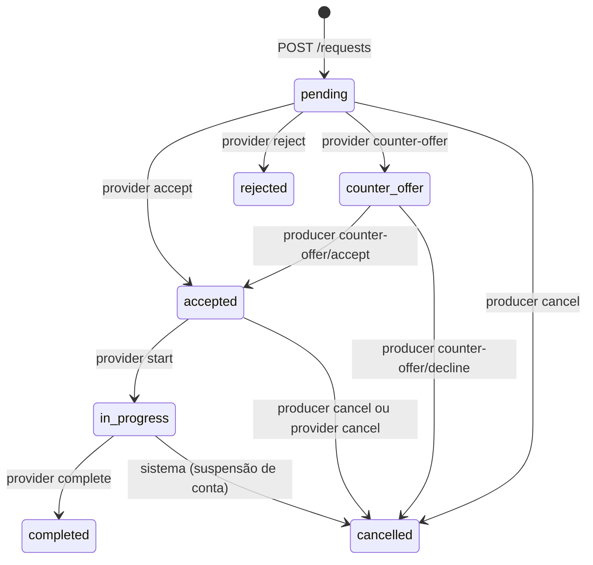

# AgroServ — Contrato da API REST

Este é o contrato entre o front-end e o back-end do AgroServ. Ele cobre:

- todos os endpoints que o front-end consome, marcados como **Implementado**;
- as regras de validação, permissão, transição e notificação de cada um.

Os endpoints existem em dois lugares com o mesmo comportamento: no adaptador mock do front-end (`src/services/api/mockRoutes.ts`) e no back-end real em [`backend/`](../backend/README.md) (NestJS + TypeORM + SQLite). Os fluxos estão em [`system-flowchart.md`](system-flowchart.md) e [`flowcharts.md`](flowcharts.md).

Este contrato é autossuficiente: tudo o que front-end e back-end precisam implementar está aqui.

O back-end deve implementar exatamente o que está aqui. O front-end troca do mock para a API real por variável de ambiente, sem mudar componentes.

A divisão do trabalho em tarefas está em [`backlog.md`](backlog.md). Cada endpoint indica a fase do backlog em que entra (F1 a F7).

## Sumário

1. [Configuração do front-end](#1-configuração-do-front-end)
2. [Convenções](#2-convenções)
3. [Erros](#3-erros)
4. [Papéis e permissões](#4-papéis-e-permissões)
5. [Tipos](#5-tipos)
6. [Ciclo de vida da solicitação](#6-ciclo-de-vida-da-solicitação)
7. [Índice de endpoints](#7-índice-de-endpoints)
8. [Autenticação e conta](#8-autenticação-e-conta)
9. [Arquivos](#9-arquivos)
10. [Catálogo público](#10-catálogo-público)
11. [Produtor](#11-produtor)
12. [Prestador](#12-prestador)
13. [Conversa, notificações e denúncias](#13-conversa-notificações-e-denúncias)
14. [Administrador](#14-administrador)
15. [Notificações geradas](#15-notificações-geradas)
16. [Dados demo](#16-dados-demo)
17. [Back-end real](#17-back-end-real)

---

## 1. Configuração do front-end

| Variável | Valores | Padrão |
|---|---|---|
| `VITE_API_MODE` | `mock` ou `http` | `mock` |
| `VITE_API_URL` | URL base da API | `http://localhost:3333` |

Para usar a API real, crie `.env` com `VITE_API_MODE=http` e `VITE_API_URL=<url>`.

---

## 2. Convenções

- **Formato:** JSON em requisições e respostas (exceto upload, seção 9). Campos em `camelCase`.
- **Envelope (back-end real):** toda resposta com corpo vem embrulhada em `{ "success": true, "data": ... }` ou `{ "success": false, "error": ... }`. Os corpos descritos neste contrato são o conteúdo de `data` e de `error`. Detalhes e motivo na [seção 17](#17-back-end-real). O mock continua devolvendo o corpo direto.
- **IDs:** `string`. O formato é livre (`usr-1`, UUID etc.).
- **Datas:** dia em `YYYY-MM-DD` (`2026-10-15`). Momentos em ISO 8601 UTC (`2026-11-09T14:30:00Z`).
- **"Hoje":** toda regra que usa a data de hoje (agendamento, início do serviço, dias bloqueados, painéis) usa o horário de Brasília (`America/Sao_Paulo`), não UTC. Assim, às 22h de 10/11 em Brasília, "hoje" ainda é 10/11.
- **Dinheiro:** reais como `number` com até 2 casas (`1440.5`). Todo valor é **estimativa**: não existe pagamento no sistema.
- **Autenticação:** `Authorization: Bearer <token>`, token obtido em `POST /auth/login` ou `POST /auth/register`. O formato do token é livre (JWT recomendado).
- **Sessão inválida:** qualquer 401 em uma requisição autenticada encerra a sessão no front-end e leva ao login. Conta suspensa ou excluída deve receber 401 em toda requisição autenticada.
- **Listas paginadas:** `{ "data": T[], "meta": { "page", "pageSize", "total", "totalPages" } }`. Parâmetros `page` (inteiro ≥ 1, padrão 1) e `pageSize` (padrão e máximo indicados em cada endpoint). Valores inválidos de `page` ou `pageSize` usam o padrão, sem erro.
- **Respostas sem corpo:** `204 No Content`.
- **Criação:** `201 Created` com o recurso criado no corpo.
- **Recursos de outros usuários:** quando o usuário não participa do recurso (solicitação, propriedade, equipamento), a API responde **404**, não 403, para não revelar que ele existe.
- **Textos:** todos os campos de texto chegam com espaços nas pontas removidos. Mensagens de erro em PT-BR, prontas para exibir.
- **Exclusões:** excluir um serviço ou uma propriedade é **lógico**: o registro fica guardado, some de todas as listagens, buscas e formulários, e continua aparecendo nas solicitações antigas que o usam. Equipamentos, favoritos e dias bloqueados são apagados de verdade.
- **Senhas:** mínimo de 8 caracteres em cadastro, redefinição, troca e criação de administrador. As contas demo (`123456`) são exceção da semente e não passam por essa validação.

---

## 3. Erros

Corpo de todo erro (no back-end real, este objeto vem dentro de `error`, conforme a [seção 17](#17-back-end-real)):

```json
{
  "status": 422,
  "code": "validation_error",
  "message": "Revise os campos destacados.",
  "fields": { "email": "Este e-mail já está cadastrado." }
}
```

`fields` só aparece em erros de formulário (422). O front-end exibe cada mensagem no campo correspondente e `message` no topo.

| Status | `code` | Quando |
|---|---|---|
| 400 | `validation_error` | Login sem e-mail ou senha (comportamento atual) |
| 400 | `invalid_status` | Filtro `status` inválido em listagens |
| 401 | `invalid_credentials` | Login incorreto ou conta excluída |
| 401 | `unauthorized` | Token ausente, inválido, de conta suspensa ou excluída |
| 403 | `forbidden` | O papel do usuário não pode usar o endpoint |
| 403 | `account_suspended` | Login de conta suspensa |
| 404 | `route_not_found` | Rota inexistente |
| 404 | `service_not_found`, `request_not_found`, `property_not_found`, `equipment_not_found`, `review_not_found`, `report_not_found`, `user_not_found`, `category_not_found`, `notification_not_found`, `upload_not_found` | Recurso inexistente ou de outro usuário |
| 404 | `provider_unavailable` | Perfil de prestador suspenso, excluído ou inexistente |
| 409 | `invalid_transition` | A ação não é permitida no status atual da solicitação ou do anúncio |
| 409 | `conflict` | Ação bloqueada por vínculos (ex.: excluir conta com solicitações abertas) |
| 409 | `service_unavailable` | Solicitar um serviço pausado, oculto ou indisponível |
| 422 | `validation_error` | Campos inválidos, com `fields` |
| 429 | `too_many_attempts` | Muitas tentativas de login (só no back-end real) |
| 500 | `server_error` | Erro inesperado |

Mensagens fixas usadas pelo front-end:

| Situação | `message` |
|---|---|
| Login incorreto | `E-mail ou senha inválidos.` |
| Conta suspensa | `Sua conta está suspensa. Entre em contato com o suporte.` |
| Sessão inválida | `Sessão inválida. Faça login novamente.` |
| Sem permissão | `Você não tem permissão para esta ação.` |
| Transição inválida (padrão) | `Esta ação não está mais disponível para esta solicitação.` |
| Formulário inválido (padrão) | `Revise os campos destacados.` |
| Data da solicitação já passou | `A data pedida já passou.` |

---

## 4. Papéis e permissões

Cada conta tem **um único papel**: `producer` (produtor), `provider` (prestador) ou `admin` (administrador). Quem quiser ser produtor e prestador cria duas contas, com e-mails diferentes.

| Grupo de endpoints | Público | Produtor | Prestador | Admin |
|---|---|---|---|---|
| `/auth/register`, `/auth/login`, `/auth/forgot-password`, `/auth/reset-password` | ✔ | ✔ | ✔ | ✔ |
| `/auth/me`, `/me`, `/me/password`, `/me/notifications`, `/uploads` | | ✔ | ✔ | ✔ |
| `DELETE /me` | | ✔ | ✔ | |
| Catálogo (`/categories`, `/services*`, `/providers/:id`) | ✔ | ✔ | ✔ | ✔ |
| `/me/properties`, `/me/favorites`, `/dashboard`, `POST /requests`, `/requests/:id/*` (ações do produtor), `/reviews/:id` | | ✔ | | |
| `GET /requests`, `GET /requests/:id` | | ✔ (próprias) | | |
| `/provider/*` | | | ✔ | |
| `/requests/:id/messages` | | ✔ (participante) | ✔ (participante) | ✔ (leitura, se houver denúncia sobre a solicitação) |
| `POST /reports` | | ✔ | ✔ | |
| `/admin/*` | | | | ✔ |

Papel errado → 403 `forbidden`. Sem token → 401 `unauthorized`.

---

## 5. Tipos

Os tipos atuais estão em `src/types/entities.ts` e `src/types/api.ts`. Abaixo, a versão completa após a ampliação. Campos marcados com `?` são opcionais.

### Usuários e prestadores

```ts
type Role = 'producer' | 'provider' | 'admin'
type UserStatus = 'active' | 'suspended' | 'deleted'

interface User {
  id: string
  name: string
  email: string
  role: Role
  phone?: string
  avatarUrl?: string
  city: string
  state: string
  status: UserStatus
  mustChangePassword?: boolean
  createdAt: string
}

type VerificationStatus = 'not_sent' | 'under_review' | 'approved' | 'rejected'

interface ProviderProfile {
  userId: string
  document: string
  serviceRadiusKm: number
  yearsOfExperience: number
  description: string
  verificationStatus: VerificationStatus
  verificationRejectionReason?: string
  rating: number
  reviewCount: number
}

interface Provider {
  id: string
  name: string
  avatarUrl?: string
  city: string
  state: string
  rating: number
  reviewCount: number
  yearsOfExperience: number
  verified: boolean
  serviceRadiusKm: number
  description: string
}
```

- `Provider` é a visão pública de um prestador. `id` é o id do usuário prestador. `verified` é `verificationStatus === 'approved'`.
- `mustChangePassword` só existe em administradores criados por outro administrador (senha provisória). Enquanto for `true`, o front-end obriga a troca de senha antes de liberar a área.
- `document` (CPF/CNPJ) nunca aparece em respostas públicas.

### Catálogo

```ts
interface Category {
  id: string
  slug: string
  name: string
  icon: CategoryIcon
  active: boolean
}

type CategoryIcon =
  | 'sprout' | 'wheat' | 'droplets' | 'spray-can' | 'flask-conical' | 'truck' | 'wrench' | 'tractor'
  | 'leaf' | 'shovel' | 'warehouse' | 'sun' | 'tree-pine' | 'beef'

type PriceUnit = 'hectare' | 'hour' | 'day' | 'trip'
type ServiceStatus = 'active' | 'paused' | 'hidden'

interface Service {
  id: string
  title: string
  description: string
  categoryId: string
  providerId: string
  providerName: string
  providerVerified: boolean
  city: string
  state: string
  price: number
  priceUnit: PriceUnit
  rating: number
  reviewCount: number
  available: boolean
  imageUrl: string
  photos: string[]
  equipmentIds: string[]
  status: ServiceStatus
  hiddenReason?: string
  createdAt: string
}

interface ServiceDetail extends Service {
  provider: Provider
  category: Category
  equipment: Equipment[]
}

type EquipmentType = 'tractor' | 'harvester' | 'sprayer' | 'drone' | 'truck' | 'implement' | 'other'

interface Equipment {
  id: string
  providerId: string
  type: EquipmentType
  model: string
  year: number
  specs: string
  photos: string[]
}
```

- `imageUrl` é a capa: `photos[0]`, ou string vazia sem fotos (o front mostra um ícone no lugar).
- `available` é controlado pelo prestador ("disponível para novas solicitações"). `status` diz se o anúncio aparece na busca.
- `hiddenReason` só aparece para o dono do anúncio e para o administrador.
- Rótulos de unidade na interface: `hectare` → `ha`, `hour` → `h`, `day` → `dia`, `trip` → `viagem`.

### Propriedades e solicitações

```ts
interface Property {
  id: string
  name: string
  city: string
  state: string
  accessNotes: string
  areaHectares: number
  crops: string[]
  createdAt: string
}

type RequestStatus =
  | 'pending' | 'counter_offer' | 'accepted' | 'in_progress'
  | 'completed' | 'rejected' | 'cancelled'

interface CounterOffer {
  date?: string
  value?: number
  message: string
  createdAt: string
}

interface ServiceRequest {
  id: string
  serviceId: string
  serviceTitle: string
  providerId: string
  providerName: string
  producerId: string
  producerName: string
  propertyId: string
  location: string
  scheduledDate: string
  quantity: number
  priceUnit: PriceUnit
  value: number
  notes?: string
  status: RequestStatus
  counterOffer?: CounterOffer
  rejectReason?: string
  cancelReason?: string
  cancelledBy?: Role | 'system'
  reviewId?: string
  createdAt: string
  updatedAt: string
}

type RequestEventType =
  | 'created' | 'accepted' | 'rejected' | 'counter_offer'
  | 'counter_offer_accepted' | 'counter_offer_declined'
  | 'started' | 'completed' | 'cancelled'

interface RequestEvent {
  id: string
  type: RequestEventType
  actorId: string | null
  actorRole: Role | 'system'
  actorName: string
  note?: string
  previousDate?: string
  previousValue?: number
  createdAt: string
}

type RequestAction =
  | 'cancel' | 'accept_counter_offer' | 'decline_counter_offer' | 'review' | 'edit_review'
  | 'accept' | 'reject' | 'counter_offer' | 'start' | 'complete'
  | 'message' | 'report'

interface RequestParty {
  id: string
  name: string
  avatarUrl?: string
  city: string
  state: string
  phone?: string
}

interface ServiceRequestDetail extends ServiceRequest {
  service: Service
  serviceRemoved: boolean
  property: Property
  propertyRemoved: boolean
  producer: RequestParty
  provider: Provider & { phone?: string }
  events: RequestEvent[]
  review?: Review
  allowedActions: RequestAction[]
}
```

- `location` é o texto pronto `"<nome da propriedade>, <cidade> - <UF>"`, guardado no momento da criação.
- `value` = `price × quantity` no momento da criação, arredondado em 2 casas. Muda só quando o produtor aceita uma contraproposta com novo valor.
- `serviceTitle`, `providerName`, `producerName` e `location` são cópias feitas na criação. O histórico não muda se o anúncio ou a propriedade forem editados depois.
- `events` vem em ordem cronológica crescente.
- `allowedActions` é calculado pela API **para quem está pedindo**, seguindo a seção 6. O front-end mostra só os botões presentes na lista.
- Telefones: `producer.phone` (para o prestador) e `provider.phone` (para o produtor) só aparecem quando o status é `accepted`, `in_progress` ou `completed`. Como o acerto é feito fora do sistema, as duas partes precisam poder se contatar depois de agendado.
- `serviceRemoved` e `propertyRemoved` são `true` quando o serviço ou a propriedade foram excluídos depois da solicitação. `service` e `property` continuam vindo, com os dados do momento da exclusão, e a interface mostra "Anúncio removido" ou "Propriedade removida".

### Avaliações, conversa e notificações

```ts
interface Review {
  id: string
  requestId: string
  serviceId: string
  serviceTitle: string
  providerId: string
  producerId: string
  producerName: string
  producerAvatarUrl?: string
  rating: 1 | 2 | 3 | 4 | 5
  comment?: string
  reply?: { text: string; createdAt: string; updatedAt: string }
  hidden: boolean
  editableUntil: string
  createdAt: string
  updatedAt: string
}

interface ReviewSummary {
  average: number
  count: number
  writtenCount: number
  distribution: { 1: number; 2: number; 3: number; 4: number; 5: number }
}

interface Message {
  id: string
  requestId: string
  senderId: string
  senderName: string
  senderRole: Role
  text: string
  createdAt: string
}

type NotificationType =
  | 'request_created' | 'request_status' | 'counter_offer' | 'message'
  | 'review' | 'review_reply' | 'verification' | 'service_hidden'
  | 'warning' | 'report_resolved' | 'report_created' | 'verification_submitted'

interface Notification {
  id: string
  type: NotificationType
  title: string
  body?: string
  link: string
  read: boolean
  createdAt: string
}
```

- `ReviewSummary.average` e `count` são os números oficiais do serviço ou do prestador (iguais a `rating` e `reviewCount`). `writtenCount` e `distribution` contam só as avaliações registradas e visíveis. Nos dados demo, as notas iniciais já existem sem avaliações registradas, então `count` pode ser maior que `writtenCount`.
- `editableUntil` = `createdAt` + 7 dias.
- `link` é a rota do front-end já certa para o papel de quem recebe (ex.: `/solicitacoes/req-9` para o produtor, `/prestador/solicitacoes/req-9` para o prestador).

### Denúncias, verificação, arquivos e administração

```ts
type ReportTargetType = 'service' | 'review' | 'user' | 'request'
type ReportReason = 'offensive' | 'false_info' | 'fraud' | 'service_not_done' | 'other'
type ReportStatus = 'open' | 'resolved' | 'dismissed'
type ReportResolutionAction = 'hide_service' | 'hide_review' | 'warn' | 'suspend' | 'archive'

interface Report {
  id: string
  reporterId: string
  reporterName: string
  reporterRole: Role
  targetType: ReportTargetType
  targetId: string
  targetLabel: string
  reason: ReportReason
  description: string
  status: ReportStatus
  resolution?: {
    action: ReportResolutionAction
    targetUserId?: string
    message?: string
    internalNote: string
    adminId: string
    adminName: string
    resolvedAt: string
  }
  createdAt: string
}

interface VerificationDocument {
  kind: 'identity' | 'address'
  uploadId: string
  url: string
  name: string
}

interface Verification {
  status: VerificationStatus
  documents: VerificationDocument[]
  submittedAt?: string
  reviewedAt?: string
  rejectionReason?: string
}

interface Upload {
  id: string
  url: string
  name: string
  contentType: string
  size: number
  purpose: 'public' | 'verification'
  createdAt: string
}

type AdminActionType =
  | 'suspend_user' | 'reactivate_user' | 'create_admin'
  | 'approve_verification' | 'reject_verification'
  | 'hide_service' | 'show_service' | 'delete_service'
  | 'hide_review' | 'warn_user' | 'resolve_report' | 'dismiss_report'
  | 'create_category' | 'update_category' | 'delete_category'

interface AdminAction {
  id: string
  adminId: string
  adminName: string
  action: AdminActionType
  targetType: 'user' | 'service' | 'review' | 'report' | 'category' | 'verification'
  targetId: string
  targetLabel: string
  reason?: string
  createdAt: string
}
```

- Rótulos dos motivos de denúncia: `offensive` Conteúdo ofensivo, `false_info` Informação falsa, `fraud` Golpe ou fraude, `service_not_done` Serviço não realizado, `other` Outro.
- `targetLabel` é um texto curto para listas (título do anúncio, nome do usuário, "Solicitação req-9 · Pulverização Agrícola").

### Painéis

```ts
interface ProducerDashboard {
  stats: { open: number; inProgress: number; completed: number; totalSpent: number }
  recentRequests: ServiceRequest[]
}

interface ProviderDashboard {
  stats: {
    newRequests: number
    upcoming: number
    inProgress: number
    acceptanceRate: number | null
    averageRating: number
    monthEstimatedValue: number
  }
  pendingRequests: ServiceRequest[]
  upcomingRequests: ServiceRequest[]
}

interface AdminDashboard {
  users: { producers: number; providers: number; admins: number }
  newUsersLast7Days: number
  requestsByStatus: Record<RequestStatus, number>
  activeServices: number
  topCategories: { categoryId: string; name: string; requests: number }[]
  pendingVerifications: number
  openReports: number
}
```

Regras de cálculo nos endpoints de cada painel.

---

## 6. Ciclo de vida da solicitação



| De | Para | Quem | Endpoint | Exige | Evento |
|---|---|---|---|---|---|
| — | `pending` | Produtor | `POST /requests` | — | `created` |
| `pending` | `accepted` | Prestador | `POST /provider/requests/:id/accept` | `scheduledDate` ≥ hoje | `accepted` |
| `pending` | `rejected` | Prestador | `POST /provider/requests/:id/reject` | `reason` | `rejected` |
| `pending` | `counter_offer` | Prestador | `POST /provider/requests/:id/counter-offer` | `message` + `date` e/ou `value` | `counter_offer` |
| `pending` | `cancelled` | Produtor | `POST /requests/:id/cancel` | — | `cancelled` |
| `counter_offer` | `accepted` | Produtor | `POST /requests/:id/counter-offer/accept` | data efetiva ≥ hoje | `counter_offer_accepted` |
| `counter_offer` | `cancelled` | Produtor | `POST /requests/:id/counter-offer/decline` | — | `counter_offer_declined` |
| `counter_offer` | `cancelled` | Produtor | `POST /requests/:id/cancel` | — | `cancelled` |
| `accepted` | `in_progress` | Prestador | `POST /provider/requests/:id/start` | hoje ≥ `scheduledDate` | `started` |
| `accepted` | `cancelled` | Produtor | `POST /requests/:id/cancel` | `reason` | `cancelled` |
| `accepted` | `cancelled` | Prestador | `POST /provider/requests/:id/cancel` | `reason` | `cancelled` |
| `in_progress` | `completed` | Prestador | `POST /provider/requests/:id/complete` | — | `completed` |
| qualquer aberto | `cancelled` | Sistema | efeito de `POST /admin/users/:id/suspend` | — | `cancelled` (`actorRole: 'system'`) |

Regras:

- **Aberto** = `pending`, `counter_offer`, `accepted` ou `in_progress`. **Encerrado** = `completed`, `rejected` ou `cancelled`.
- `accepted` significa data confirmada. A interface mostra "Agendada".
- Só uma contraproposta por solicitação: ela só pode ser feita a partir de `pending`, e recusá-la encerra a solicitação.
- Ao aceitar a contraproposta, `scheduledDate` e/ou `value` recebem os valores propostos. O evento `counter_offer_accepted` guarda `previousDate` e `previousValue`.
- Usuários e administradores nunca levam `in_progress` para `cancelled`. Só a suspensão de conta faz isso.
- **Datas que já passaram:** o prestador só aceita se a data pedida for hoje ou depois. Se passou, ele faz uma contraproposta com nova data, ou recusa. O produtor só aceita a contraproposta se a data efetiva (a proposta, ou a original quando a proposta muda só o valor) for hoje ou depois. Se passou, ele recusa ou cancela. Não existe expiração automática: a interface mostra o aviso `A data pedida já passou.` nessas solicitações.
- Qualquer ação fora da tabela responde 409 `invalid_transition`. Isso inclui telas desatualizadas: o front-end mostra a mensagem e recarrega a solicitação.
- Toda transição gera um `RequestEvent` e notifica a outra parte (seção 15).

Rótulos na interface:

| Status | Rótulo |
|---|---|
| `pending` | Pendente |
| `counter_offer` | Contraproposta |
| `accepted` | Agendada |
| `in_progress` | Em andamento |
| `completed` | Concluída |
| `rejected` | Recusada |
| `cancelled` | Cancelada |

`allowedActions` por papel e status:

| Status | Produtor | Prestador |
|---|---|---|
| `pending` | `cancel`, `message`, `report` | `accept` (só se a data não passou), `reject`, `counter_offer`, `message`, `report` |
| `counter_offer` | `accept_counter_offer` (só se a data efetiva não passou), `decline_counter_offer`, `cancel`, `message`, `report` | `message`, `report` |
| `accepted` | `cancel`, `message`, `report` | `start` (só a partir da data), `cancel`, `message`, `report` |
| `in_progress` | `message`, `report` | `complete`, `message`, `report` |
| `completed` | `review` (sem avaliação) ou `edit_review` (dentro de 7 dias), `report` | `report` |
| `rejected`, `cancelled` | `report` | `report` |

---

## 7. Índice de endpoints

| Método e rota | Papel | Situação | Fase |
|---|---|---|---|
| `POST /auth/register` | Público | Implementado | F1 |
| `POST /auth/login` | Público | Implementado | F1 |
| `GET /auth/me` | Autenticado | Implementado | F1 |
| `POST /auth/forgot-password` | Público | Implementado | F1 |
| `POST /auth/reset-password` | Público | Implementado | F1 |
| `PATCH /me` | Autenticado | Implementado | F1 |
| `PATCH /me/password` | Autenticado | Implementado | F1 |
| `DELETE /me` | Produtor, Prestador | Implementado | F1 |
| `POST /uploads` | Autenticado | Implementado | F3 |
| `GET /categories` | Público | Implementado | F6 |
| `GET /services` | Público | Implementado | F3, F5, F7 |
| `GET /services/featured` | Público | Implementado | F3 |
| `GET /services/:id` | Público | Implementado | F3, F5 |
| `GET /services/:id/reviews` | Público | Implementado | F4 |
| `GET /services/:id/blocked-days` | Público | Implementado | F5 |
| `GET /providers/:id` | Público | Implementado | F7 |
| `GET /me/properties` | Produtor | Implementado | F2 |
| `POST /me/properties` | Produtor | Implementado | F2 |
| `PATCH /me/properties/:id` | Produtor | Implementado | F2 |
| `DELETE /me/properties/:id` | Produtor | Implementado | F2 |
| `POST /requests` | Produtor | Implementado | F2 |
| `GET /requests` | Produtor | Implementado | F2 |
| `GET /requests/:id` | Produtor | Implementado | F2 |
| `POST /requests/:id/cancel` | Produtor | Implementado | F2 |
| `POST /requests/:id/counter-offer/accept` | Produtor | Implementado | F2 |
| `POST /requests/:id/counter-offer/decline` | Produtor | Implementado | F2 |
| `POST /requests/:id/review` | Produtor | Implementado | F4 |
| `PATCH /reviews/:id` | Produtor | Implementado | F4 |
| `GET /dashboard` | Produtor | Implementado | F2 |
| `GET /me/favorites` | Produtor | Implementado | F7 |
| `POST /me/favorites` | Produtor | Implementado | F7 |
| `DELETE /me/favorites/:serviceId` | Produtor | Implementado | F7 |
| `GET /provider/profile` | Prestador | Implementado | F1 |
| `PATCH /provider/profile` | Prestador | Implementado | F1 |
| `GET /provider/dashboard` | Prestador | Implementado | F3 |
| `GET /provider/services` | Prestador | Implementado | F3 |
| `GET /provider/services/:id` | Prestador | Implementado | F3 |
| `POST /provider/services` | Prestador | Implementado | F3 |
| `PATCH /provider/services/:id` | Prestador | Implementado | F3 |
| `POST /provider/services/:id/pause` | Prestador | Implementado | F3 |
| `POST /provider/services/:id/activate` | Prestador | Implementado | F3 |
| `DELETE /provider/services/:id` | Prestador | Implementado | F3 |
| `GET /provider/requests` | Prestador | Implementado | F3 |
| `GET /provider/requests/:id` | Prestador | Implementado | F3 |
| `POST /provider/requests/:id/accept` | Prestador | Implementado | F3 |
| `POST /provider/requests/:id/reject` | Prestador | Implementado | F3 |
| `POST /provider/requests/:id/counter-offer` | Prestador | Implementado | F3 |
| `POST /provider/requests/:id/start` | Prestador | Implementado | F3 |
| `POST /provider/requests/:id/complete` | Prestador | Implementado | F3 |
| `POST /provider/requests/:id/cancel` | Prestador | Implementado | F3 |
| `GET /provider/equipment` | Prestador | Implementado | F5 |
| `POST /provider/equipment` | Prestador | Implementado | F5 |
| `PATCH /provider/equipment/:id` | Prestador | Implementado | F5 |
| `DELETE /provider/equipment/:id` | Prestador | Implementado | F5 |
| `GET /provider/agenda` | Prestador | Implementado | F5 |
| `POST /provider/blocked-days` | Prestador | Implementado | F5 |
| `DELETE /provider/blocked-days/:date` | Prestador | Implementado | F5 |
| `GET /provider/reviews` | Prestador | Implementado | F4 |
| `PUT /provider/reviews/:id/reply` | Prestador | Implementado | F4 |
| `GET /provider/verification` | Prestador | Implementado | F5 |
| `POST /provider/verification` | Prestador | Implementado | F5 |
| `GET /requests/:id/messages` | Participante, Admin | Implementado | F4 |
| `POST /requests/:id/messages` | Participante | Implementado | F4 |
| `GET /me/notifications` | Autenticado | Implementado | F4 |
| `POST /me/notifications/:id/read` | Autenticado | Implementado | F4 |
| `POST /me/notifications/read-all` | Autenticado | Implementado | F4 |
| `POST /reports` | Produtor, Prestador | Implementado | F6 |
| `GET /admin/dashboard` | Admin | Implementado | F6 |
| `GET /admin/users` | Admin | Implementado | F6 |
| `POST /admin/users` | Admin | Implementado | F6 |
| `GET /admin/users/:id` | Admin | Implementado | F6 |
| `GET /admin/requests/:id` | Admin | Implementado | F6 |
| `POST /admin/users/:id/suspend` | Admin | Implementado | F6 |
| `POST /admin/users/:id/reactivate` | Admin | Implementado | F6 |
| `GET /admin/verifications` | Admin | Implementado | F6 |
| `POST /admin/verifications/:providerId/approve` | Admin | Implementado | F6 |
| `POST /admin/verifications/:providerId/reject` | Admin | Implementado | F6 |
| `GET /admin/services` | Admin | Implementado | F6 |
| `POST /admin/services/:id/hide` | Admin | Implementado | F6 |
| `POST /admin/services/:id/show` | Admin | Implementado | F6 |
| `DELETE /admin/services/:id` | Admin | Implementado | F6 |
| `GET /admin/reports` | Admin | Implementado | F6 |
| `GET /admin/reports/:id` | Admin | Implementado | F6 |
| `POST /admin/reports/:id/resolve` | Admin | Implementado | F6 |
| `GET /admin/categories` | Admin | Implementado | F6 |
| `POST /admin/categories` | Admin | Implementado | F6 |
| `PATCH /admin/categories/:id` | Admin | Implementado | F6 |
| `DELETE /admin/categories/:id` | Admin | Implementado | F6 |
| `GET /admin/actions` | Admin | Implementado | F6 |

---

## 8. Autenticação e conta

### `POST /auth/register` — Implementado (F1)
Público. Cria uma conta de produtor ou prestador e já devolve a sessão.

Corpo:

| Campo | Regra | Mensagem de erro |
|---|---|---|
| `name` | 2 a 120 caracteres | `Informe seu nome.` |
| `email` | e-mail válido, único (sem diferenciar maiúsculas, ignorando contas excluídas) | `Informe um e-mail válido.` / `Este e-mail já está cadastrado.` |
| `password` | mínimo 8 caracteres | `A senha precisa ter pelo menos 8 caracteres.` |
| `phone` | 10 ou 11 dígitos depois de remover pontuação | `Informe um telefone válido.` |
| `city` | 2 a 80 caracteres | `Informe sua cidade.` |
| `state` | UF brasileira de 2 letras | `Selecione a UF.` |
| `role` | `producer` ou `provider` | `Escolha como você vai usar o AgroServ.` |
| `acceptedTerms` | `true` | `Aceite os termos de uso e a política de privacidade.` |

O back-end guarda a data do aceite dos termos (LGPD). As páginas de termos e privacidade ficam em `/termos` e `/privacidade`.

201: `{ "token": string, "user": User }`. 422 com `fields`.

Efeitos: se `role` for `provider`, cria um `ProviderProfile` com `document: ""`, `serviceRadiusKm: 50`, `yearsOfExperience: 0`, `description: ""`, `verificationStatus: "not_sent"`, `rating: 0`, `reviewCount: 0`.

### `POST /auth/login` — Implementado (F1)
Corpo: `{ "email": string, "password": string }`. E-mail comparado sem diferenciar maiúsculas e sem espaços nas pontas.

200: `{ "token": string, "user": User }`.

| Situação | Resposta |
|---|---|
| Falta campo | 400 `validation_error`, `Informe e-mail e senha.` |
| Credenciais erradas ou conta excluída | 401 `invalid_credentials`, `E-mail ou senha inválidos.` |
| Conta suspensa (senha correta) | 403 `account_suspended`, `Sua conta está suspensa. Entre em contato com o suporte.` |
| Muitas tentativas | 429 `too_many_attempts`, `Muitas tentativas. Aguarde alguns minutos e tente de novo.` (só no back-end real: 5 tentativas erradas por e-mail em 15 minutos) |

Mudança: hoje só existe o produtor demo. Depois, qualquer papel faz login. O front-end leva cada papel à sua área (`/dashboard`, `/prestador/dashboard`, `/admin`).

Token: válido por 7 dias. Depois disso, qualquer requisição recebe 401 e o usuário entra de novo. Não há renovação automática nesta versão.

### `GET /auth/me` — Implementado (F1)
Autenticado. 200: `User`. 401 se o token for inválido ou se a conta estiver suspensa ou excluída. O front-end apaga a sessão somente no 401.

### `POST /auth/forgot-password` — Implementado (F1)
Público. Corpo: `{ "email": string }`.

200 (sempre, exista ou não a conta): `{ "message": "Se o e-mail existir, enviaremos um link." }`.

Produção: envia e-mail com o link `<URL do front-end>/redefinir-senha?token=<token>`. O token vale 60 minutos e só pode ser usado uma vez. Pedir de novo invalida o token anterior. Limite de 3 pedidos por e-mail por hora (acima disso, a resposta é a mesma, mas nenhum e-mail sai).

Mock: como não há e-mail, a resposta inclui `"resetToken": string` quando a conta existe, e a tela mostra o link. **O back-end real não deve devolver `resetToken`.**

### `POST /auth/reset-password` — Implementado (F1)
Público. Corpo: `{ "token": string, "password": string }`.

200: `{ "message": "Senha redefinida. Entre com a nova senha." }`.

422: `fields.token` `Link inválido ou expirado.` (inexistente, vencido ou já usado), `fields.password` mínimo 8 caracteres.

### `PATCH /me` — Implementado (F1)
Autenticado. Corpo parcial: `name`, `phone`, `city`, `state` (mesmas regras do cadastro) e `avatarUrl` (URL devolvida por `POST /uploads`, ou `null` para remover).

200: `User` atualizado. O e-mail não pode ser alterado nesta versão.

### `PATCH /me/password` — Implementado (F1)
Autenticado. Corpo: `{ "currentPassword": string, "newPassword": string }`.

200: `{ "message": "Senha alterada." }`. 422: `fields.currentPassword` `Senha atual incorreta.`; `fields.newPassword` mínimo 8 caracteres e diferente da atual (`A nova senha precisa ser diferente da atual.`).

Efeito: `mustChangePassword` vira `false`.

### `DELETE /me` — Implementado (F1)
Produtor ou prestador. Administradores não se excluem (403).

200: `{ "message": "Conta excluída." }`.

409 `conflict`, `Você tem solicitações em andamento. Conclua ou cancele antes de excluir a conta.` quando a conta participa de alguma solicitação aberta.

Efeitos (exclusão lógica):

- `status` vira `deleted`. A conta não entra mais e some de listagens e buscas.
- O e-mail é liberado (anonimizado) e pode ser usado em um cadastro novo.
- Solicitações e avaliações antigas mantêm o nome.
- Produtor: propriedades removidas (exclusão lógica) e favoritos apagados.
- Prestador: anúncios ficam `hidden` com `hiddenReason: "Conta excluída"`, equipamentos e dias bloqueados são apagados, e `GET /providers/:id` passa a responder 404 `provider_unavailable`.

---

## 9. Arquivos

### `POST /uploads` — Implementado (F3)
Autenticado. Envia um arquivo e devolve a URL para usar em outros endpoints (`avatarUrl`, `photos`, documentos de verificação).

Produção: `multipart/form-data` com o campo `file`.

Mock: JSON `{ "name": string, "contentType": string, "dataUrl": string, "purpose": "public" | "verification" }`. O arquivo fica salvo no navegador (IndexedDB) e a URL tem o formato `mockfile:<id>`.

Em produção, `purpose` vai como campo do formulário, junto com `file`.

| Regra | Valor |
|---|---|
| Tipos aceitos | `image/jpeg`, `image/png`, `image/webp`, `application/pdf` |
| Tamanho máximo | 5 MB por arquivo |
| Imagens | o front-end reduz para no máximo 1280 px no maior lado antes de enviar |

201: `Upload`. 422: `fields.file` `Envie uma imagem JPG, PNG ou WEBP, ou um PDF.` / `O arquivo deve ter no máximo 5 MB.`

URLs de upload só podem ser usadas pelo próprio usuário que enviou. Uma URL de outro usuário nos campos `photos`, `avatarUrl` ou documentos → 422 no campo correspondente.

Visibilidade (LGPD):

| `purpose` | Uso | Quem pode abrir o arquivo |
|---|---|---|
| `public` (padrão) | foto de perfil, fotos de serviço e de equipamento | qualquer pessoa |
| `verification` | documentos de verificação (CPF/CNPJ, comprovante de endereço) | só o próprio prestador e administradores. No back-end real, a URL exige autenticação ou é assinada e expira. |

Um upload `verification` não pode ser usado como foto, e um `public` não pode ser usado como documento: 422 no campo correspondente.

---

## 10. Catálogo público

Regra geral de visibilidade: um serviço aparece em buscas, destaques, favoritos e perfil público só quando `status === 'active'` e o prestador está `active`. Categoria desativada sai dos filtros e do formulário de novo serviço, mas os serviços já publicados nela continuam visíveis. Serviços de prestadores suspensos somem da busca sem mudar de status, e voltam quando a conta é reativada.

### `GET /categories` — Implementado (F6)
200: `Category[]` com `active: true`, na ordem de cadastro.

Mudança: o campo `active` passa a existir, e categorias desativadas deixam de aparecer. A lista completa fica em `GET /admin/categories`.

### `GET /services` — Implementado (F3, F5, F7)
Query (todas opcionais):

| Parâmetro | Regra | Situação |
|---|---|---|
| `q` | Todos os termos devem aparecer em título, descrição, prestador, categoria ou cidade. Sem diferenciar acento, caixa ou pontuação. | Implementado |
| `location` | Todos os termos devem aparecer em cidade + UF (`Santa Helena, PR` encontra `Santa Helena - PR`). | Implementado |
| `category` | `slug` da categoria. Slug inexistente ou de categoria desativada retorna lista vazia. | Implementado |
| `page` | Inteiro ≥ 1. Padrão 1. | Implementado |
| `pageSize` | Inteiro ≥ 1, máximo 60. Padrão 9. | Implementado |
| `priceUnit` | `hectare`, `hour`, `day` ou `trip`: só serviços cobrados nessa unidade. | Implementado (F7) |
| `minPrice`, `maxPrice` | Número ≥ 0, comparado com `price`. **Só valem junto com `priceUnit`**: sem ele, são ignorados, porque comparar preço por hora com preço por hectare não faz sentido. | Implementado (F7) |
| `minRating` | Número de 1 a 5, compara com `rating`. | Implementado (F7) |
| `verified` | `true`: só prestadores verificados. | Implementado (F7) |
| `date` | `YYYY-MM-DD`: só serviços `available` cujo prestador não bloqueou esse dia. | Implementado (F7) |
| `sort` | `relevance` (padrão, ordem de cadastro), `price_asc`, `price_desc`, `rating` (nota e depois número de avaliações). | Implementado (F7) |

Valores inválidos nesses filtros são ignorados, sem erro.

200: `Paginated<Service>`.

Mudanças: aplica a regra geral de visibilidade (F3) e os novos campos de `Service` (`providerVerified`, `photos`, `status` etc.).

### `GET /services/featured` — Implementado (F3)
Query: `limit` (padrão 4, máximo 12).

200: `Service[]` visíveis e com `available: true`, ordenados por avaliação e número de avaliações.

### `GET /services/:id` — Implementado (F3, F5)
200: `ServiceDetail` (serviço + `provider` + `category` + `equipment`).

404 `service_not_found` quando o serviço não existe **ou** não está visível. Exceção: o prestador dono e o administrador recebem o detalhe de qualquer status, com `hiddenReason` se houver.

### `GET /services/:id/reviews` — Implementado (F4)
Query: `page`, `pageSize` (padrão 10, máximo 50), `rating` (1 a 5, opcional).

200:

```json
{ "data": [Review], "meta": { "page": 1, "pageSize": 10, "total": 3, "totalPages": 1 }, "summary": ReviewSummary }
```

Avaliações ocultas não aparecem. Ordem: mais recentes primeiro. 404 `service_not_found` como em `GET /services/:id`.

### `GET /services/:id/blocked-days` — Implementado (F5)
Query: `from` e `to` (`YYYY-MM-DD`, padrão hoje até hoje + 90 dias, intervalo máximo de 366 dias).

200: `string[]` com os dias bloqueados pelo prestador do serviço, em ordem crescente. O formulário de solicitação desabilita esses dias.

### `GET /providers/:id` — Implementado (F7)
200:

```ts
interface ProviderPublicProfile {
  provider: Provider
  services: Service[]
  equipment: Equipment[]
  recentReviews: Review[]
  reviewSummary: ReviewSummary
}
```

`services` só traz os visíveis. `recentReviews` traz as 5 mais recentes não ocultas.

404 `provider_unavailable`, `Prestador não está mais na plataforma.`, quando o usuário não é prestador, ou está suspenso ou excluído.

---

## 11. Produtor

### `GET /me/properties` — Implementado (F2)
200: `Property[]` do produtor, por `createdAt` crescente.

### `POST /me/properties` — Implementado (F2)
Corpo:

| Campo | Regra | Mensagem |
|---|---|---|
| `name` | 2 a 80 caracteres | `Informe o nome da propriedade.` |
| `city` | 2 a 80 caracteres | `Informe a cidade.` |
| `state` | UF de 2 letras | `Selecione a UF.` |
| `accessNotes` | até 500 caracteres, opcional (padrão `""`) | `Use no máximo 500 caracteres.` |
| `areaHectares` | número > 0 e ≤ 1.000.000 | `Informe a área em hectares.` |
| `crops` | até 10 itens, cada um com 2 a 40 caracteres, sem repetidos | `Informe até 10 culturas.` |

201: `Property`. 422 com `fields`.

### `PATCH /me/properties/:id` — Implementado (F2)
Corpo parcial com as mesmas regras. 200: `Property`. 404 `property_not_found`.

Editar não muda solicitações já criadas (elas guardam `location` como cópia).

### `DELETE /me/properties/:id` — Implementado (F2)
204. 404 `property_not_found`. 409 `conflict`, `Esta propriedade tem solicitações em aberto.`

Exclusão lógica: a propriedade some da lista e do formulário de solicitação, e continua nas solicitações antigas (`propertyRemoved: true`).

### `POST /requests` — Implementado (F2)
Produtor. Corpo:

| Campo | Regra | Mensagem |
|---|---|---|
| `serviceId` | serviço visível | 404 `service_not_found` |
| `propertyId` | propriedade do próprio produtor | `Selecione uma propriedade.` |
| `scheduledDate` | `YYYY-MM-DD`, ≥ hoje, não bloqueado pelo prestador | `Escolha uma data a partir de hoje.` / `O prestador não atende nesta data.` |
| `quantity` | número > 0 e ≤ 100.000, na unidade do serviço | `Informe a quantidade.` |
| `notes` | até 1000 caracteres, opcional | `Use no máximo 1000 caracteres.` |

Serviço visível mas com `available: false` → 409 `service_unavailable`, `Este serviço não está disponível para novas solicitações.`

201: `ServiceRequestDetail` com `status: "pending"`, `value = price × quantity`, `priceUnit` do serviço e evento `created`.

Efeitos: notifica o prestador (`request_created`). O raio de atendimento **não** bloqueia a criação. O aviso de distância é só do front-end.

### `GET /requests` — Implementado (F2)
Produtor. Query: `status` opcional (qualquer `RequestStatus` ou `all`). Status inválido: 400 `invalid_status`.

200: `ServiceRequest[]` do produtor, por `scheduledDate` decrescente.

Mudança: entram os status `counter_offer` e `rejected` e os novos campos de `ServiceRequest`.

### `GET /requests/:id` — Implementado (F2)
Produtor dono da solicitação. 200: `ServiceRequestDetail`. 404 `request_not_found`.

### `POST /requests/:id/cancel` — Implementado (F2)
Produtor. Corpo: `{ "reason"?: string }` (5 a 500 caracteres). Obrigatório quando o status é `accepted`: `Informe o motivo do cancelamento.`

Permitido em `pending`, `counter_offer` e `accepted`. 200: `ServiceRequestDetail` com `status: "cancelled"`, `cancelledBy: "producer"`. 409 `invalid_transition` nos demais.

Efeitos: evento `cancelled`; notifica o prestador.

### `POST /requests/:id/counter-offer/accept` — Implementado (F2)
Produtor. Só em `counter_offer` e com a data efetiva (a proposta, ou a original se a proposta mudou só o valor) hoje ou depois. Data passada: 409 `invalid_transition`, `A data proposta já passou. Recuse a proposta ou cancele a solicitação.`

200: `ServiceRequestDetail` com `status: "accepted"`, `scheduledDate` e `value` atualizados pela proposta, `counterOffer` mantido para histórico. Evento `counter_offer_accepted` com `previousDate` e `previousValue`.

Efeitos: notifica o prestador.

### `POST /requests/:id/counter-offer/decline` — Implementado (F2)
Produtor. Só em `counter_offer`.

200: `ServiceRequestDetail` com `status: "cancelled"`, `cancelledBy: "producer"`, `cancelReason: "Contraproposta recusada pelo produtor"`. Evento `counter_offer_declined`.

Efeitos: notifica o prestador.

### `POST /requests/:id/review` — Implementado (F4)
Produtor. Corpo: `{ "rating": 1..5, "comment"?: string }` (comentário até 1000 caracteres).

Só em `completed` e uma vez por solicitação: 409 `conflict`, `Você já avaliou esta solicitação.`; status diferente → 409 `invalid_transition`.

201: `Review`.

Efeitos:
- grava `reviewId` na solicitação;
- atualiza `rating` e `reviewCount` do serviço e do prestador: `novaMédia = (média × total + nota) / (total + 1)`;
- notifica o prestador (`review`).

### `PATCH /reviews/:id` — Implementado (F4)
Produtor autor. Corpo parcial: `rating`, `comment`.

Até `editableUntil` (7 dias). Depois: 409 `conflict`, `O prazo para editar esta avaliação terminou.`

200: `Review`. A mudança de nota ajusta as médias: `média += (notaNova − notaAntiga) / total`.

### `GET /dashboard` — Implementado (F2)
Produtor. 200: `ProducerDashboard`:

- `stats.open`: `pending` + `counter_offer` + `accepted`
- `stats.inProgress`: `in_progress`
- `stats.completed`: `completed`
- `stats.totalSpent`: soma de `value` em `accepted`, `in_progress` e `completed` (valor estimado, não é pagamento). A interface mostra "Total estimado contratado".
- `recentRequests`: as 5 mais recentes por `scheduledDate`

Mudança: `open` passa a contar `counter_offer`.

### `GET /me/favorites` — Implementado (F7)
200: `Service[]` favoritados e visíveis, do mais recente para o mais antigo.

### `POST /me/favorites` — Implementado (F7)
Corpo: `{ "serviceId": string }`. 200: o `Service` favoritado. Idempotente: favoritar de novo responde 200 com o mesmo serviço. 404 `service_not_found`.

### `DELETE /me/favorites/:serviceId` — Implementado (F7)
204, idempotente (remover algo que não está nos favoritos também responde 204).

---

## 12. Prestador

### `GET /provider/profile` — Implementado (F1)
200: `ProviderProfile` do prestador autenticado.

### `PATCH /provider/profile` — Implementado (F1)
Corpo parcial:

| Campo | Regra | Mensagem |
|---|---|---|
| `document` | 11 dígitos (CPF) ou 14 (CNPJ) depois de remover pontuação | `Informe um CPF ou CNPJ válido.` |
| `serviceRadiusKm` | inteiro de 1 a 500 | `Informe um raio entre 1 e 500 km.` |
| `yearsOfExperience` | inteiro de 0 a 80 | `Informe os anos de experiência.` |
| `description` | até 1000 caracteres | `Use no máximo 1000 caracteres.` |

200: `ProviderProfile`. Nome, telefone, cidade e foto ficam em `PATCH /me`.

Alterar `document` com verificação `approved` ou `under_review` volta a verificação para `not_sent`.

### `GET /provider/dashboard` — Implementado (F3)
200: `ProviderDashboard`:

| Campo | Cálculo |
|---|---|
| `newRequests` | solicitações `pending` |
| `upcoming` | `accepted` com `scheduledDate` entre hoje e hoje + 7 dias |
| `inProgress` | `in_progress` |
| `acceptanceRate` | entre as solicitações que o prestador respondeu nos últimos 90 dias (primeira resposta `accepted`, `rejected` ou `counter_offer`), a fração que terminou aceita (`accepted` direto ou contraproposta aceita). `null` sem respostas no período. Valor de 0 a 1. |
| `averageRating` | `rating` do perfil |
| `monthEstimatedValue` | soma de `value` das `completed` concluídas no mês atual (pelo evento `completed`). Estimativa, sem pagamento. |
| `pendingRequests` | até 5 `pending`, mais antigas primeiro |
| `upcomingRequests` | até 5 `accepted` dos próximos 7 dias, por data |

### `GET /provider/services` — Implementado (F3)
200: `Service[]` do prestador em qualquer status, mais recentes primeiro.

### `GET /provider/services/:id` — Implementado (F3)
200: `ServiceDetail`. 404 `service_not_found` se não for dele.

### `POST /provider/services` — Implementado (F3)
Corpo:

| Campo | Regra | Mensagem |
|---|---|---|
| `title` | 3 a 80 caracteres | `Informe o título.` |
| `categoryId` | categoria ativa | `Selecione uma categoria.` |
| `description` | 20 a 2000 caracteres | `Descreva o serviço com pelo menos 20 caracteres.` |
| `price` | número > 0 | `Informe o preço.` |
| `priceUnit` | `hectare`, `hour`, `day` ou `trip` | `Selecione a unidade.` |
| `city`, `state` | como no cadastro | — |
| `photos` | até 8 URLs de `POST /uploads` do próprio prestador | `Use no máximo 8 fotos.` |
| `equipmentIds` | equipamentos do próprio prestador | `Equipamento inválido.` |
| `available` | boolean, padrão `true` | — |

201: `Service` com `status: "active"`. **Vai para a busca na hora**, sem aprovação. Prestador não verificado também publica.

### `PATCH /provider/services/:id` — Implementado (F3)
Corpo parcial com as mesmas regras. 200: `Service`. Um anúncio `hidden` pode ser editado, mas continua oculto.

### `POST /provider/services/:id/pause` — Implementado (F3)
`active` → `paused` (some da busca). 200: `Service`.

409 `invalid_transition` se já estiver pausado. Se estiver oculto: 409 `invalid_transition`, `Anúncio oculto pela administração.`

### `POST /provider/services/:id/activate` — Implementado (F3)
`paused` → `active`. 200: `Service`. Oculto: 409 `invalid_transition`, `Anúncio oculto pela administração.`

### `DELETE /provider/services/:id` — Implementado (F3)
204. 409 `conflict`, `Este serviço tem solicitações em aberto. Pause o anúncio em vez de excluir.`

Exclusão lógica: o anúncio some da lista do prestador, da busca, dos favoritos e do perfil público, e continua nas solicitações e avaliações antigas (`serviceRemoved: true`). Depois de excluído, `GET /services/:id` e `GET /provider/services/:id` respondem 404 `service_not_found`.

### `GET /provider/requests` — Implementado (F3)
Query: `status` opcional (como em `GET /requests`).

200: `ServiceRequest[]` recebidas, por `createdAt` decrescente.

### `GET /provider/requests/:id` — Implementado (F3)
200: `ServiceRequestDetail` (inclui a propriedade: área, culturas, acesso). 404 `request_not_found`.

### `POST /provider/requests/:id/accept` — Implementado (F3)
`pending` → `accepted`, só se `scheduledDate` ≥ hoje. Data passada: 409 `invalid_transition`, `A data pedida já passou. Faça uma contraproposta com uma nova data.`

200: `ServiceRequestDetail`. Aceitar é permitido mesmo se o dia estiver bloqueado: quem decide é o prestador.

Efeitos: evento `accepted`; notifica o produtor.

### `POST /provider/requests/:id/reject` — Implementado (F3)
Corpo: `{ "reason": string }` (5 a 500 caracteres, `Informe o motivo da recusa.`).

`pending` → `rejected`. 200: `ServiceRequestDetail` com `rejectReason`. Efeitos: evento `rejected`; notifica o produtor.

### `POST /provider/requests/:id/counter-offer` — Implementado (F3)
Corpo: `{ "date"?: string, "value"?: number, "message": string }`.

| Regra | Mensagem |
|---|---|
| pelo menos um entre `date` e `value`, diferente do atual | `Proponha uma nova data ou um novo valor.` |
| `date` ≥ hoje | `Escolha uma data a partir de hoje.` |
| `value` > 0 (valor **total**, não por unidade) | `Informe um valor válido.` |
| `message` de 5 a 500 caracteres | `Explique a proposta ao produtor.` |

A quantidade não muda. `pending` → `counter_offer`. 200: `ServiceRequestDetail` com `counterOffer`.

Efeitos: evento `counter_offer`; notifica o produtor (`counter_offer`).

### `POST /provider/requests/:id/start` — Implementado (F3)
`accepted` → `in_progress`, só se hoje ≥ `scheduledDate`. Antes disso: 409 `invalid_transition`, `O serviço só pode ser iniciado a partir da data agendada.`

200: `ServiceRequestDetail`. Efeitos: evento `started`; notifica o produtor.

### `POST /provider/requests/:id/complete` — Implementado (F3)
`in_progress` → `completed`. 200: `ServiceRequestDetail`.

Efeitos: evento `completed`; notifica o produtor com o título `Serviço concluído. Conte como foi.`

### `POST /provider/requests/:id/cancel` — Implementado (F3)
Corpo: `{ "reason": string }` (5 a 500 caracteres, obrigatório).

`accepted` → `cancelled`, `cancelledBy: "provider"`. Em `pending`, o prestador usa `reject`. 200: `ServiceRequestDetail`. Efeitos: evento `cancelled`; notifica o produtor.

### `GET /provider/equipment` — Implementado (F5)
200: `Equipment[]` do prestador.

### `POST /provider/equipment` — Implementado (F5)
Corpo:

| Campo | Regra | Mensagem |
|---|---|---|
| `type` | `EquipmentType` | `Selecione o tipo.` |
| `model` | 2 a 80 caracteres (marca e modelo) | `Informe marca e modelo.` |
| `year` | inteiro de 1950 até o ano atual + 1 | `Informe um ano válido.` |
| `specs` | até 500 caracteres | `Use no máximo 500 caracteres.` |
| `photos` | até 6 URLs de upload | `Use no máximo 6 fotos.` |

201: `Equipment`. Rótulos dos tipos: `tractor` Trator, `harvester` Colheitadeira, `sprayer` Pulverizador, `drone` Drone, `truck` Caminhão, `implement` Implemento, `other` Outro.

### `PATCH /provider/equipment/:id` — Implementado (F5)
Corpo parcial. 200: `Equipment`. 404 `equipment_not_found`.

### `DELETE /provider/equipment/:id` — Implementado (F5)
204. Remove também o id de `equipmentIds` dos serviços do prestador.

### `GET /provider/agenda` — Implementado (F5)
Query: `month` (`YYYY-MM`, padrão mês atual).

200:

```json
{ "month": "2026-11", "blockedDays": ["2026-11-20"], "requests": [ServiceRequest] }
```

`requests` traz as solicitações `accepted`, `in_progress` e `completed` com `scheduledDate` no mês. Não há limite de serviços por dia.

### `POST /provider/blocked-days` — Implementado (F5)
Corpo: `{ "date": string }` (≥ hoje: `Escolha uma data a partir de hoje.`).

201: `{ "date": string }`. Idempotente: bloquear um dia já bloqueado também responde 201.

Bloquear não cancela solicitações já aceitas naquele dia. Só impede solicitações novas.

### `DELETE /provider/blocked-days/:date` — Implementado (F5)
204, idempotente.

### `GET /provider/reviews` — Implementado (F4)
Query: `page`, `pageSize` (padrão 10, máximo 50), `rating` (1 a 5).

200: `{ data: Review[], meta, summary: ReviewSummary }` das avaliações recebidas, incluindo as ocultas (com `hidden: true`, para o prestador saber).

### `PUT /provider/reviews/:id/reply` — Implementado (F4)
Corpo: `{ "text": string }` (2 a 1000 caracteres). Cria ou edita a resposta pública (uma por avaliação).

200: `Review`. 404 `review_not_found` se não for avaliação dele. Efeitos: na primeira resposta, notifica o produtor (`review_reply`).

### `GET /provider/verification` — Implementado (F5)
200: `Verification`.

### `POST /provider/verification` — Implementado (F5)
Corpo: `{ "identityUploadId": string, "addressUploadId": string }` (uploads do próprio prestador, imagem ou PDF, enviados com `purpose: "verification"`).

Permitido em `not_sent` e `rejected`. Em `under_review` ou `approved`: 409 `conflict`, `Sua verificação já foi enviada.`

Também exige `document` preenchido no perfil: 422 `fields.document` `Preencha o CPF ou CNPJ no seu perfil antes de enviar.`

200: `Verification` com `status: "under_review"`. Efeitos: notifica os administradores (`verification_submitted`).

---

## 13. Conversa, notificações e denúncias

### `GET /requests/:id/messages` — Implementado (F4)
Produtor ou prestador da solicitação. Administrador só quando existe denúncia (qualquer status) com `targetType: "request"` e esse `targetId`.

200: `Message[]` em ordem cronológica crescente. 404 `request_not_found` para os demais.

### `POST /requests/:id/messages` — Implementado (F4)
Produtor ou prestador da solicitação. Corpo: `{ "text": string }` (1 a 2000 caracteres, `Escreva uma mensagem de até 2000 caracteres.`).

Só com a solicitação aberta. Encerrada: 409 `conflict`, `Esta conversa está encerrada.`

201: `Message`. Efeitos: notifica a outra parte (`message`). Mensagens seguidas da mesma pessoa sobre a mesma solicitação, enquanto a notificação anterior não foi lida, não geram notificação nova.

Sem tempo real: o front-end recarrega a conversa ao abrir a tela e depois de enviar.

### `GET /me/notifications` — Implementado (F4)
Autenticado. Query: `page`, `pageSize` (padrão 20, máximo 50), `unreadOnly` (`true`).

200:

```json
{ "data": [Notification], "meta": { ... }, "unreadCount": 3 }
```

Ordem: mais recentes primeiro. O sino usa `pageSize=10`.

### `POST /me/notifications/:id/read` — Implementado (F4)
204. 404 `notification_not_found` se não for do usuário.

### `POST /me/notifications/read-all` — Implementado (F4)
204.

### `POST /reports` — Implementado (F6)
Produtor ou prestador. Corpo: `{ "targetType", "targetId", "reason", "description" }` (`description` de 10 a 1000 caracteres, `Descreva o problema com pelo menos 10 caracteres.`).

Quem pode denunciar o quê:

| Papel | `targetType` permitido |
|---|---|
| Produtor | `service` (qualquer anúncio visível), `user` (um prestador com quem tem ou teve solicitação), `request` (as próprias) |
| Prestador | `review` (avaliações recebidas), `user` (um produtor com quem tem ou teve solicitação), `request` (as recebidas) |

Alvo não permitido: 422 `fields.targetType` `Você não pode denunciar este item.` Alvo inexistente: 404 com o código do recurso. Já existe denúncia aberta do mesmo usuário para o mesmo alvo: 409 `conflict`, `Você já denunciou este item. Aguarde a análise.`

201: `Report` com `status: "open"`. Efeitos: notifica os administradores (`report_created`).

---

## 14. Administrador

Toda ação de escrita nesta seção grava um `AdminAction` (histórico).

### `GET /admin/dashboard` — Implementado (F6)
200: `AdminDashboard`:

| Campo | Cálculo |
|---|---|
| `users` | contas não excluídas por papel |
| `newUsersLast7Days` | contas criadas nos últimos 7 dias |
| `requestsByStatus` | total de solicitações por status (todos os status presentes, com 0 quando não houver) |
| `activeServices` | serviços visíveis |
| `topCategories` | 5 categorias com mais solicitações (todas as épocas), em ordem decrescente |
| `pendingVerifications` | prestadores em `under_review` |
| `openReports` | denúncias `open` |

### `GET /admin/users` — Implementado (F6)
Query: `q` (nome ou e-mail, sem diferenciar acento e caixa), `role`, `status` (`active` ou `suspended`; contas excluídas não aparecem), `page`, `pageSize` (padrão 20, máximo 100).

200: `Paginated<User>`, mais recentes primeiro.

### `POST /admin/users` — Implementado (F6)
Cria outro administrador. Corpo: `{ "name", "email", "password", "city", "state" }` (mesmas regras do cadastro; `password` é a senha provisória).

201: `User` com `role: "admin"` e `mustChangePassword: true`. No primeiro acesso, o novo administrador é obrigado a trocar a senha (`PATCH /me/password`). Efeitos: `AdminAction` `create_admin`.

### `GET /admin/users/:id` — Implementado (F6)
200:

```ts
interface AdminUserDetail {
  user: User
  providerProfile?: ProviderProfile
  requests: ServiceRequest[]
  services?: Service[]
  reviews: Review[]
  actions: AdminAction[]
}
```

- `requests`: as 20 mais recentes em que o usuário é produtor ou prestador. Cada uma abre em `GET /admin/requests/:id`.
- `services`: só para prestadores, em qualquer status.
- `reviews`: escritas (produtor) ou recebidas (prestador), incluindo ocultas.
- `actions`: histórico administrativo sobre essa conta.

404 `user_not_found`.

### `GET /admin/requests/:id` — Implementado (F6)
Detalhe de qualquer solicitação, somente leitura. 200: `ServiceRequestDetail` com `allowedActions: []` e os telefones das duas partes. 404 `request_not_found`.

A conversa da solicitação continua liberada para o administrador só quando há denúncia sobre ela (`GET /requests/:id/messages`).

### `POST /admin/users/:id/suspend` — Implementado (F6)
Corpo: `{ "reason": string }` (5 a 500 caracteres).

| Situação | Resposta |
|---|---|
| Suspender a si mesmo | 409 `conflict`, `Você não pode suspender a sua própria conta.` |
| Último administrador ativo | 409 `conflict`, `É preciso manter pelo menos um administrador ativo.` |
| Já suspensa | 409 `conflict`, `Esta conta já está suspensa.` |

200: `User` com `status: "suspended"`.

Efeitos (vale para produtor e prestador):

1. A conta não entra mais, e qualquer requisição com o token dela recebe 401.
2. Todas as solicitações abertas da conta (`pending`, `counter_offer`, `accepted`, `in_progress`) viram `cancelled`, com `cancelledBy: "system"`, `cancelReason: "Conta suspensa pela administração"` e evento `cancelled` de `actorRole: "system"`.
3. A outra parte de cada uma dessas solicitações é notificada (`request_status`).
4. Prestador: os anúncios somem da busca pela regra de visibilidade, sem mudar de status.
5. Avaliações já escritas continuam visíveis. Denúncias abertas pela conta continuam na fila.
6. `AdminAction` `suspend_user` com o motivo.

### `POST /admin/users/:id/reactivate` — Implementado (F6)
200: `User` com `status: "active"`. O acesso volta e os anúncios voltam a aparecer no estado em que estavam. Solicitações canceladas pela suspensão não voltam.

409 `conflict`, `Esta conta já está ativa.` Contas excluídas não podem ser reativadas (409 `conflict`). Efeitos: `AdminAction` `reactivate_user`.

### `GET /admin/verifications` — Implementado (F6)
200: lista dos prestadores em `under_review`, enviados há mais tempo primeiro:

```ts
{ provider: Provider; email: string; document: string; verification: Verification }[]
```

### `POST /admin/verifications/:providerId/approve` — Implementado (F6)
Só em `under_review` (senão 409 `invalid_transition`). 200: `Verification` com `status: "approved"`.

Efeitos: `verified: true` em todos os lugares; notifica o prestador (`verification`, `Sua verificação foi aprovada.`); `AdminAction` `approve_verification`.

### `POST /admin/verifications/:providerId/reject` — Implementado (F6)
Corpo: `{ "reason": string }` (5 a 500 caracteres). Só em `under_review`.

200: `Verification` com `status: "rejected"` e `rejectionReason`. Efeitos: notifica o prestador com o motivo; `AdminAction` `reject_verification`. O prestador pode corrigir e reenviar.

### `GET /admin/services` — Implementado (F6)
Query: `q` (como em `GET /services`), `category` (slug), `status` (`active`, `paused` ou `hidden`), `page`, `pageSize` (padrão 20, máximo 100).

200: `Paginated<Service>` em qualquer status, incluindo `hiddenReason`.

### `POST /admin/services/:id/hide` — Implementado (F6)
Corpo: `{ "reason": string }` (5 a 500 caracteres).

O anúncio vai para `hidden` e o back-end guarda o status anterior (`active` ou `paused`). Já oculto: 409 `invalid_transition`.

200: `Service`. Efeitos: notifica o prestador (`service_hidden`) com o motivo; `AdminAction` `hide_service`.

### `POST /admin/services/:id/show` — Implementado (F6)
Volta ao status anterior ao ocultamento. Não oculto: 409 `invalid_transition`. Ocultado por exclusão de conta: 409 `conflict`, `O prestador excluiu a conta.`

200: `Service`. Efeitos: `AdminAction` `show_service`.

### `DELETE /admin/services/:id` — Implementado (F6)
204. 409 `conflict` com solicitações abertas (mesma mensagem do prestador). Exclusão lógica, como em `DELETE /provider/services/:id`. Efeitos: notifica o prestador (`service_hidden`, `Seu anúncio foi removido pela administração`); `AdminAction` `delete_service`.

### `GET /admin/reports` — Implementado (F6)
Query: `status` (padrão `open`; aceita `all`), `targetType`, `page`, `pageSize` (padrão 20, máximo 100).

200: `Paginated<Report>`. Abertas: mais antigas primeiro. Demais: mais recentes primeiro.

### `GET /admin/reports/:id` — Implementado (F6)
200:

```ts
interface ReportDetail {
  report: Report
  target: Service | Review | User | ServiceRequestDetail
  messages?: Message[]
}
```

`target` é o estado atual do alvo, mesmo que oculto ou excluído. `messages` vem quando o alvo é uma solicitação. 404 `report_not_found`.

### `POST /admin/reports/:id/resolve` — Implementado (F6)
Corpo:

| Campo | Regra |
|---|---|
| `action` | permitido pelo tipo de alvo (tabela abaixo) |
| `targetUserId` | obrigatório quando o alvo é `request` e a ação é `warn` ou `suspend`: o produtor ou o prestador da solicitação. Nos outros casos é deduzido. |
| `message` | obrigatório em `hide_service`, `warn` e `suspend` (5 a 500 caracteres). É o texto que o usuário afetado recebe: motivo do ocultamento, texto da advertência ou motivo da suspensão. |
| `internalNote` | obrigatório (5 a 1000 caracteres). **Só administradores veem.** Nunca é enviada a usuários. |

| Alvo | Ações permitidas | Usuário afetado em `warn`/`suspend` |
|---|---|---|
| `service` | `hide_service`, `warn`, `suspend`, `archive` | o prestador do anúncio |
| `review` | `hide_review`, `warn`, `suspend`, `archive` | o produtor autor |
| `user` | `warn`, `suspend`, `archive` | o usuário denunciado |
| `request` | `warn`, `suspend`, `archive` | `targetUserId` |

Só em denúncias `open` (senão 409 `invalid_transition`). Ação não permitida: 422 `fields.action`.

200: `Report` com `status: "dismissed"` (para `archive`) ou `"resolved"` (demais) e `resolution`.

Efeitos:

| Ação | Efeito |
|---|---|
| `hide_service` | igual a `POST /admin/services/:id/hide`, usando `message` como motivo enviado ao prestador |
| `hide_review` | `hidden: true`; a nota sai da média do serviço e do prestador (`média = (média × total − nota) / (total − 1)`, ou 0 se zerar) |
| `warn` | notificação `warning` ao usuário com `message` |
| `suspend` | igual a `POST /admin/users/:id/suspend` com `message` como motivo |
| `archive` | nenhum efeito sobre o alvo |

Em todos os casos: notifica quem denunciou (`report_resolved`, `Sua denúncia foi analisada.`, sem detalhes da ação) e grava `AdminAction` (`resolve_report` ou `dismiss_report`, mais `hide_review`/`warn_user` quando aplicável).

### `GET /admin/categories` — Implementado (F6)
200: `(Category & { serviceCount: number })[]`, incluindo desativadas.

### `POST /admin/categories` — Implementado (F6)
Corpo: `{ "name": string, "slug"?: string, "icon": CategoryIcon }`.

| Campo | Regra | Mensagem |
|---|---|---|
| `name` | 2 a 40 caracteres, único | `Informe o nome.` / `Já existe uma categoria com este nome.` |
| `slug` | minúsculas, números e hífen; único; gerado a partir do nome se ausente | `Já existe uma categoria com este endereço.` |
| `icon` | um dos `CategoryIcon` | `Selecione um ícone.` |

201: `Category` com `active: true`. Efeitos: `AdminAction` `create_category`.

### `PATCH /admin/categories/:id` — Implementado (F6)
Corpo parcial: `name`, `slug`, `icon`, `active`. 200: `Category`.

Desativar tira a categoria dos filtros e do formulário de novo serviço. Os serviços já publicados continuam visíveis. Efeitos: `AdminAction` `update_category`.

### `DELETE /admin/categories/:id` — Implementado (F6)
204. 409 `conflict`, `Esta categoria tem serviços. Desative em vez de apagar.` Efeitos: `AdminAction` `delete_category`.

### `GET /admin/actions` — Implementado (F6)
Query: `adminId`, `action` (`AdminActionType`), `from` e `to` (`YYYY-MM-DD`, inclusive), `page`, `pageSize` (padrão 20, máximo 100).

200: `Paginated<AdminAction>`, mais recentes primeiro. Somente leitura: não existe endpoint para editar ou apagar ações.

---

## 15. Notificações geradas

Notificações aparecem só dentro do sistema (sem e-mail, SMS ou push nesta etapa).

| Evento | Quem recebe | `type` | `title` | `link` |
|---|---|---|---|---|
| Nova solicitação | Prestador | `request_created` | `Nova solicitação: <serviço>` | `/prestador/solicitacoes/:id` |
| Solicitação aceita | Produtor | `request_status` | `Sua solicitação foi agendada` | `/solicitacoes/:id` |
| Solicitação recusada | Produtor | `request_status` | `Sua solicitação foi recusada` | `/solicitacoes/:id` |
| Contraproposta | Produtor | `counter_offer` | `Você recebeu uma contraproposta` | `/solicitacoes/:id` |
| Contraproposta aceita | Prestador | `request_status` | `Contraproposta aceita` | `/prestador/solicitacoes/:id` |
| Contraproposta recusada | Prestador | `request_status` | `Contraproposta recusada` | `/prestador/solicitacoes/:id` |
| Cancelada pelo produtor | Prestador | `request_status` | `Solicitação cancelada pelo produtor` | `/prestador/solicitacoes/:id` |
| Cancelada pelo prestador | Produtor | `request_status` | `Solicitação cancelada pelo prestador` | `/solicitacoes/:id` |
| Cancelada por suspensão | A outra parte | `request_status` | `Solicitação cancelada pela administração` | rota da solicitação no papel de quem recebe |
| Serviço iniciado | Produtor | `request_status` | `Serviço em andamento` | `/solicitacoes/:id` |
| Serviço concluído | Produtor | `request_status` | `Serviço concluído. Conte como foi.` | `/solicitacoes/:id` |
| Nova mensagem | A outra parte | `message` | `Nova mensagem de <nome>` | rota da solicitação |
| Nova avaliação | Prestador | `review` | `Você recebeu uma avaliação de <n> estrelas` | `/prestador/avaliacoes` |
| Resposta à avaliação | Produtor | `review_reply` | `<prestador> respondeu à sua avaliação` | `/servicos/:serviceId` |
| Verificação aprovada | Prestador | `verification` | `Sua verificação foi aprovada.` | `/prestador/verificacao` |
| Verificação rejeitada | Prestador | `verification` | `Sua verificação foi rejeitada` (motivo em `body`) | `/prestador/verificacao` |
| Anúncio oculto | Prestador | `service_hidden` | `Seu anúncio foi ocultado` (motivo em `body`) | `/prestador/servicos` |
| Anúncio removido pela administração | Prestador | `service_hidden` | `Seu anúncio foi removido pela administração` | `/prestador/servicos` |
| Advertência | Usuário advertido | `warning` | `Aviso da administração` (texto em `body`) | `/notificacoes` no papel de quem recebe |
| Denúncia analisada | Quem denunciou | `report_resolved` | `Sua denúncia foi analisada.` | `/notificacoes` no papel de quem recebe |
| Nova denúncia | Todos os admins | `report_created` | `Nova denúncia: <motivo>` | `/admin/denuncias` |
| Verificação enviada | Todos os admins | `verification_submitted` | `Nova verificação de <prestador>` | `/admin/verificacoes` |

Rotas de notificações por papel: `/notificacoes`, `/prestador/notificacoes`, `/admin/notificacoes`.

---

## 16. Dados demo

O mock e o ambiente de desenvolvimento do back-end devem ter estes dados iniciais, para todas as telas terem conteúdo.

| Papel | E-mail | Senha | Id |
|---|---|---|---|
| Produtor | `produtor@agroserv.com` | `123456` | `usr-1` |
| Prestador | `prestador@agroserv.com` (Agro Máquinas Paraná) | `123456` | `prv-1` |
| Prestador | `prestador2@agroserv.com` … `prestador6@agroserv.com` | `123456` | `prv-2` … `prv-6` |
| Administrador | `admin@agroserv.com` | `123456` | `adm-1` |

A senha `123456` das contas demo tem menos de 8 caracteres de propósito, para facilitar a demonstração. Ela é gravada direto na semente e não passa pela regra de senha mínima.

- Os 6 prestadores e os 12 serviços atuais (`src/data`) continuam com os mesmos ids, notas e números de avaliações.
- Verificação: `prv-1`, `prv-2` e `prv-6` aprovados; `prv-3` em análise; `prv-4` e `prv-5` sem envio.
- O produtor demo tem ao menos uma propriedade e ao menos uma solicitação em cada status com o prestador demo.
- Ao menos uma denúncia aberta e uma verificação em análise, para o painel do administrador.
- No mock, "Restaurar dados demo" (no perfil de cada papel) apaga o que foi salvo no navegador e volta a estes dados.

---

## 17. Back-end real

O back-end fica em [`backend/`](../backend/README.md) (NestJS + TypeORM + SQLite) e implementa todos os endpoints do índice da seção 7. Esta seção registra o que ele faz além ou diferente do mock.

### Envelope de resposta

**Motivo:** a descrição do trabalho de back-end da disciplina exige "respostas padronizadas de sucesso e de erro (interceptor e filtro global)". Por isso o back-end embrulha toda resposta com corpo, em vez de devolver o corpo direto como o mock faz.

Sucesso (qualquer 200 ou 201):

```json
{ "success": true, "data": { "token": "...", "user": { } } }
```

Erro (qualquer 4xx ou 5xx):

```json
{
  "success": false,
  "error": {
    "status": 422,
    "code": "validation_error",
    "message": "Revise os campos destacados.",
    "fields": { "email": "Este e-mail já está cadastrado." }
  }
}
```

- `data` é exatamente o corpo descrito em cada endpoint. Em listas paginadas, `data` é o objeto `{ data, meta }` inteiro.
- `error` é exatamente o objeto da seção 3.
- Respostas `204` continuam sem corpo.
- `GET /uploads/:id/file` devolve o arquivo, sem envelope.

### Ajustes feitos no front-end para usar `VITE_API_MODE=http`

> **Situação:** todos os ajustes abaixo já foram feitos. O front-end roda com `VITE_API_MODE=http` contra o back-end sem mudar componentes, e o modo `mock` continua funcionando. A tabela fica como registro do que mudou.

| # | Problema | Onde | O que fazer |
|---|---|---|---|
| 1 | Sucesso vem em `{ success, data }`, e o front lê o corpo direto | `src/services/api/httpAdapter.ts` | Devolver `body.data` |
| 2 | Erro vem em `{ success, error }`, e o front lê `code` e `message` no topo | `httpAdapter.ts` | Ler `body.error.code`, `body.error.message` e `body.error.fields` |
| 3 | O `ApiError` não recebe `fields`, então erros 422 não aparecem nos campos | `httpAdapter.ts`, `apiError.ts`, `src/types/api.ts` | Repassar `fields` (previsto em F1-01; conferir se já foi feito) |
| 4 | `HttpMethod` não tem `PUT`, e o `apiClient` só expõe `get` e `post` | `src/types/api.ts`, `apiClient.ts` | Acrescentar `PUT` e os métodos `patch`, `put` e `delete` |
| 5 | Todo corpo é enviado como JSON, mas `POST /uploads` exige `multipart/form-data` | `httpAdapter.ts` e o serviço de upload (F3-01) | Mandar `FormData` sem definir `Content-Type` |

Só o `httpAdapter` muda de comportamento. O mock **não** deve passar a usar o envelope: ele continua devolvendo o corpo direto, e o adaptador HTTP é quem desembrulha.

#### Passo 1 a 3 — `httpAdapter.ts`

Trecho final de `request`, depois do `fetch` (exemplo sobre a versão da etapa 1; adapte se F1-01 já mudou o arquivo):

```ts
if (response.status === 204) return undefined as T
const body: unknown = await response.json().catch(() => null)
const envelope = (body ?? {}) as { success?: boolean; data?: unknown; error?: Partial<ApiErrorBody> }
if (!response.ok || envelope.success === false) {
  const error = envelope.error ?? {}
  throw new ApiError({
    status: error.status ?? response.status,
    code: error.code ?? 'http_error',
    message: error.message ?? 'Erro inesperado no servidor.',
    fields: error.fields,
  })
}
return envelope.data as T
```

E em `src/types/api.ts`, `ApiErrorBody` ganha `fields?: Record<string, string>`. O construtor de `ApiError` precisa guardar esse campo.

#### Passo 4 — métodos HTTP

```ts
export type HttpMethod = 'GET' | 'POST' | 'PATCH' | 'PUT' | 'DELETE'
```

No objeto devolvido por `createApiClient`:

```ts
patch<T>(path: string, body?: unknown): Promise<T> {
  return send<T>({ method: 'PATCH', path, body, token: getAuthToken() })
},
put<T>(path: string, body?: unknown): Promise<T> {
  return send<T>({ method: 'PUT', path, body, token: getAuthToken() })
},
delete<T>(path: string): Promise<T> {
  return send<T>({ method: 'DELETE', path, token: getAuthToken() })
},
```

O mock também precisa responder a esses métodos (parte de F1-01).

#### Passo 5 — upload

No `httpAdapter`, quando o corpo for `FormData`, enviar como está e não definir `Content-Type` (o navegador põe o `boundary`):

```ts
const isForm = body instanceof FormData
if (body !== undefined && !isForm) headers['Content-Type'] = 'application/json'
const payload = body === undefined ? undefined : isForm ? body : JSON.stringify(body)
```

No serviço de upload, montar o formulário só no modo `http`:

```ts
const form = new FormData()
form.append('file', file)
form.append('purpose', purpose)
return apiClient.post<Upload>('/uploads', form)
```

No modo `mock`, continua o JSON com `dataUrl` da seção 9. A URL devolvida pelo back-end (`http://…/uploads/<id>/file`) já abre direto em ``, sem o tratamento de `mockfile:`.

#### Como rodar e conferir

1. Back-end: `cd backend && pnpm install && cp .env.example .env && pnpm start:dev` (sobe em `http://localhost:3333`). No `.env` do back, `CORS_ORIGIN` e `FRONTEND_URL` precisam apontar para o endereço do front (padrão `http://localhost:5173`).
2. Front-end: criar `.env` na raiz com `VITE_API_MODE=http` e `VITE_API_URL=http://localhost:3333`, e rodar `npm run dev`.
3. Conferir:
   - [ ] Login das três contas demo leva à área de cada papel.
   - [ ] Busca, destaques e detalhe do serviço carregam, com as fotos.
   - [ ] Um cadastro com e-mail repetido mostra o erro **no campo** de e-mail (prova que `fields` chegou).
   - [ ] Editar perfil (`PATCH`), responder avaliação (`PUT`) e remover propriedade (`DELETE`) funcionam.
   - [ ] Trocar a foto de perfil (upload) funciona e a imagem aparece.
   - [ ] Sem token, ou com conta suspensa, o front volta ao login (401).
   - [ ] "Esqueci minha senha" envia o e-mail (exige SMTP configurado no `.env` do back; ver o README do back-end).

### Arquivos

- `POST /uploads` aceita só `multipart/form-data` (o formato JSON com `dataUrl` é exclusivo do mock).
- A URL devolvida tem o formato `<PUBLIC_URL>/uploads/<id>/file` e pode ser usada direto em ``.
- Uploads `verification` devolvem a URL com `?token=<assinatura>`, válida por 10 minutos. Sem a assinatura, o arquivo só abre com o `Authorization` do próprio prestador ou de um administrador. Os demais recebem 404 `upload_not_found`.
- As URLs dos documentos em `GET /provider/verification` e `GET /admin/verifications` são assinadas de novo a cada resposta.
- Usar a URL de outro usuário, ou de um upload `verification`, em `avatarUrl` ou `photos` responde 422 com `Use apenas imagens enviadas por você.`

### Recuperação de senha

- O link `<FRONTEND_URL>/redefinir-senha?token=<token>` é enviado por e-mail de verdade, via SMTP (variáveis `SMTP_HOST`, `SMTP_PORT`, `SMTP_USER`, `SMTP_PASS` e `MAIL_FROM`, descritas no README do back-end).
- `resetToken` **nunca** é devolvido na resposta. Esse campo existe só no mock.
- Se o envio falhar ou o SMTP não estiver configurado, a resposta continua sendo a mesma (200) e a falha fica registrada no log da API.

### Outros detalhes

- **Limite geral:** 300 requisições por minuto por IP. Acima disso, 429 `too_many_attempts`.
- **Médias:** `rating` sai com no máximo 2 casas decimais.
- **Busca:** quando o prestador muda de nome ou a categoria é renomeada, a busca por texto já reflete o novo nome.
- **Mensagens que o contrato não fixava:**

| Situação | Resposta |
|---|---|
| Pausar anúncio já pausado | 409 `invalid_transition`, `Este anúncio já está pausado.` |
| Ativar anúncio já ativo | 409 `invalid_transition`, `Este anúncio já está ativo.` |
| Ocultar anúncio já oculto | 409 `invalid_transition`, `Este anúncio já está oculto.` |
| Mostrar anúncio que não está oculto | 409 `invalid_transition`, `Este anúncio não está oculto.` |
| Decidir verificação fora de análise | 409 `invalid_transition`, `Esta verificação não está em análise.` |
| Resolver denúncia já analisada | 409 `invalid_transition`, `Esta denúncia já foi analisada.` |
| Reativar conta excluída | 409 `conflict`, `Contas excluídas não podem ser reativadas.` |
| Contraproposta sem mudança de data ou valor | 422 em `fields.date`, `Proponha uma nova data ou um novo valor.` |
| Ação de denúncia não permitida para o alvo | 422 em `fields.action`, `Ação não permitida para esta denúncia.` |
| Resolver denúncia sem a mensagem obrigatória | 422 em `fields.message`, `Escreva a mensagem para o usuário.` |
| Denúncia de solicitação sem `targetUserId` válido | 422 em `fields.targetUserId`, `Escolha o produtor ou o prestador da solicitação.` |
| Documento de verificação inválido | 422 em `fields.identityUploadId` ou `fields.addressUploadId`, `Envie o documento novamente.` |
| Nota de avaliação fora de 1 a 5 | 422 em `fields.rating`, `Escolha uma nota de 1 a 5.` |
| Slug de categoria em formato inválido | 422 em `fields.slug`, `Use apenas letras minúsculas, números e hífen.` |

### Dados demo no back-end

Além do que a seção 16 exige, o seed cria: 13 solicitações (as 8 originais mais 5 entre o produtor demo e o prestador demo, uma em cada status), uma avaliação registrada (`rev-1`), dois equipamentos do prestador demo, uma conversa, um favorito, um dia bloqueado e a denúncia `rep-1`. As datas são relativas ao dia em que o seed roda, para sempre haver solicitações futuras e passadas.

