# AgroServ — Fluxogramas da Ampliação (histórico)

> **Histórico.** Este arquivo foi o plano da ampliação para três papéis: **produtor**, **prestador** e **administrador**. Tudo o que está aqui foi implementado no front-end e no back-end. A descrição do sistema atual fica em [`system-flowchart.md`](system-flowchart.md) e os diagramas com imagem em [`flowcharts.md`](flowcharts.md). O texto abaixo foi mantido como registro do planejamento.

Regras detalhadas de cada fluxo: [`api-contract.md`](api-contract.md). Tarefas e telas: [`backlog.md`](backlog.md).

1. [Mapa geral de telas](#1-mapa-geral-de-telas)
2. [Cadastro, login e recuperação de senha](#2-cadastro-login-e-recuperação-de-senha)
3. [Jornada do produtor](#3-jornada-do-produtor)
4. [Ciclo de status da solicitação](#4-ciclo-de-status-da-solicitação)
5. [Negociação entre produtor e prestador](#5-negociação-entre-produtor-e-prestador)
6. [Prestador: anúncios](#6-prestador-anúncios)
7. [Prestador: solicitações recebidas e agenda](#7-prestador-solicitações-recebidas-e-agenda)
8. [Prestador: verificação](#8-prestador-verificação)
9. [Administrador: usuários e suspensão](#9-administrador-usuários-e-suspensão)
10. [Administrador: denúncias](#10-administrador-denúncias)
11. [Administrador: anúncios e categorias](#11-administrador-anúncios-e-categorias)
12. [Avaliações](#12-avaliações)
13. [Notificações e conversa](#13-notificações-e-conversa)

Legenda de cores usada nos diagramas:

| Cor | Significado |
|-----|-------------|
| Verde-claro | Público |
| Verde-escuro | Produtor |
| Azul | Prestador |
| Laranja | Administrador |
| Cinza | Sistema |

---

## 1. Mapa geral de telas

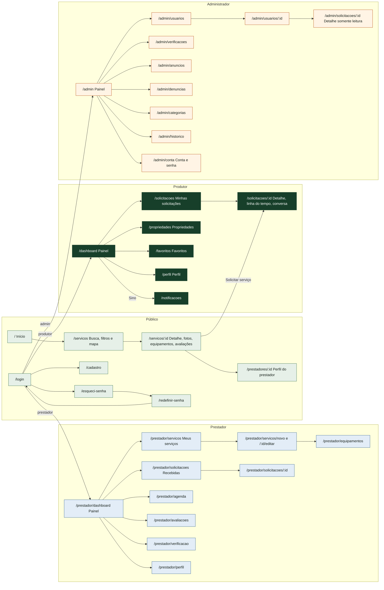

Cada conta tem um único papel. Quem tenta abrir a área de outro papel volta para a própria área com o aviso "Você não tem acesso a esta área."

---

## 2. Cadastro, login e recuperação de senha

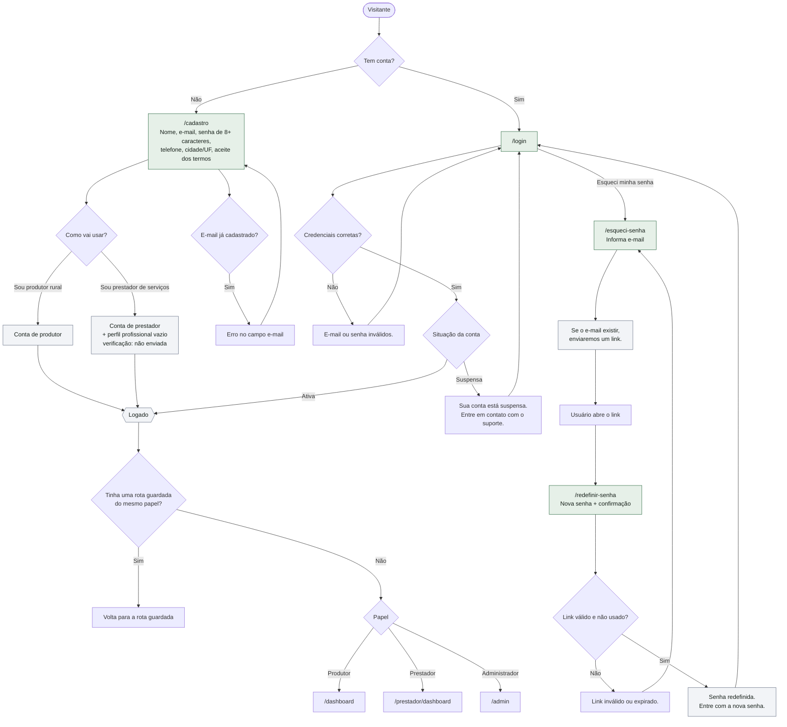

Administradores não se cadastram. Outro administrador cria a conta em `/admin/usuarios` com uma senha provisória, que precisa ser trocada no primeiro acesso.

---

## 3. Jornada do produtor

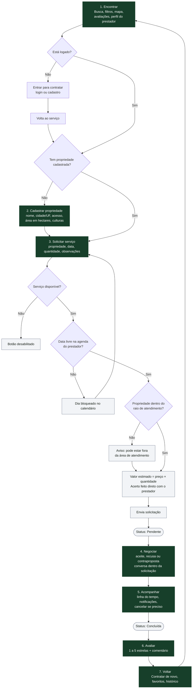

Não há pagamento no sistema. O valor exibido é sempre uma estimativa.

---

## 4. Ciclo de status da solicitação

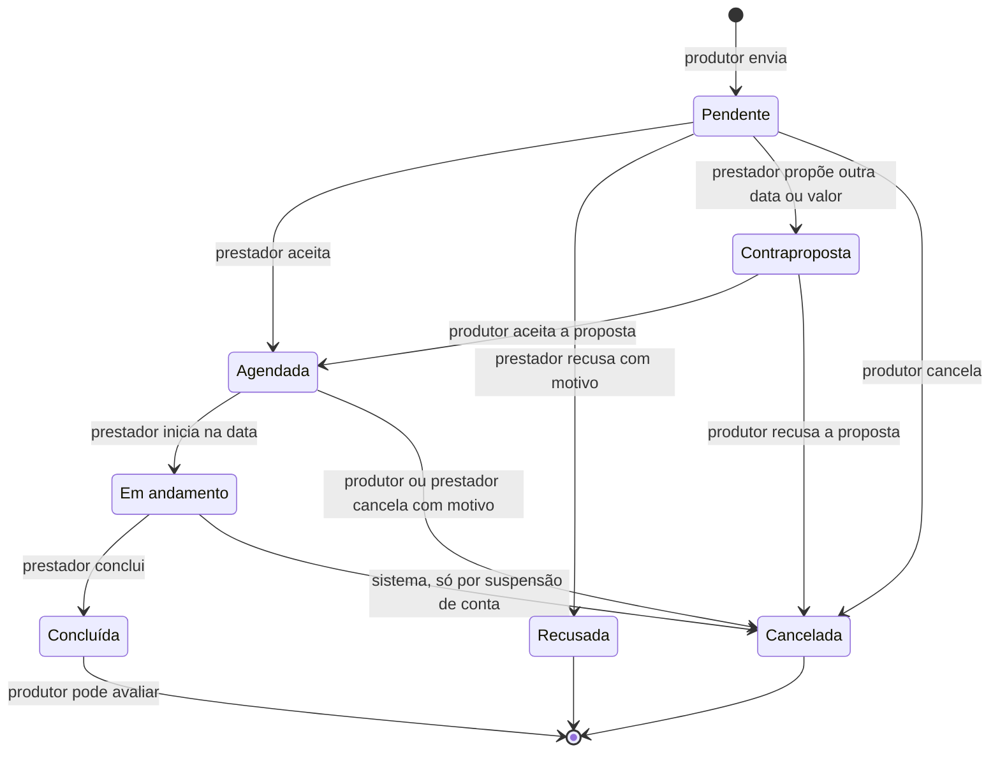

| Status | Quem pode agir |
|---|---|
| Pendente | Prestador responde. Produtor pode cancelar. |
| Contraproposta | Produtor aceita ou recusa. |
| Agendada | Prestador inicia a partir da data. Os dois podem cancelar. |
| Em andamento | Prestador conclui. |
| Concluída | Produtor avalia. |
| Recusada / Cancelada | Ninguém. A solicitação está encerrada. |

Toda mudança gera um evento na linha do tempo (quem, quando, motivo) e uma notificação para a outra parte.

**Datas que já passaram:** o prestador só aceita se a data pedida for hoje ou depois; se passou, faz uma contraproposta com nova data ou recusa. O produtor só aceita a contraproposta se a data efetiva for hoje ou depois. "Hoje" é sempre a data de Brasília.

A partir de **Agendada**, produtor e prestador veem o telefone um do outro, já que o acerto é feito fora do sistema.

---

## 5. Negociação entre produtor e prestador

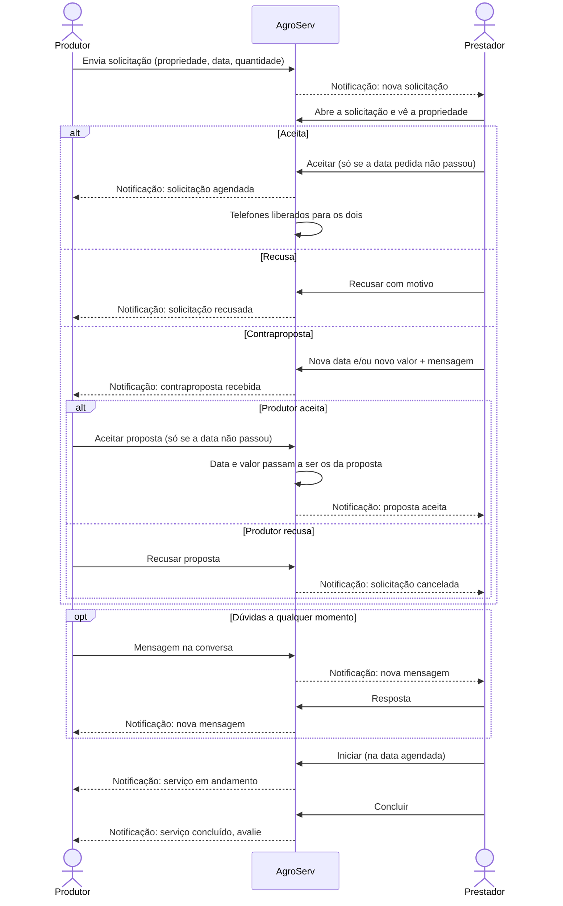

Só uma contraproposta por solicitação. Se o produtor recusar, ele cria uma solicitação nova para negociar de novo.

---

## 6. Prestador: anúncios

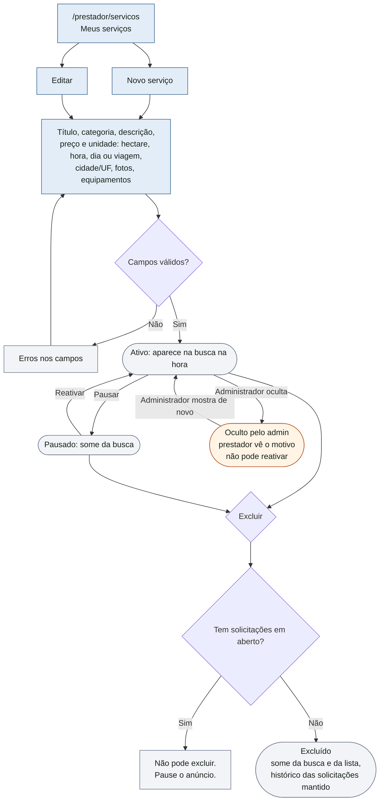

Prestadores não verificados também publicam. A diferença é o selo "verificado".

---

## 7. Prestador: solicitações recebidas e agenda

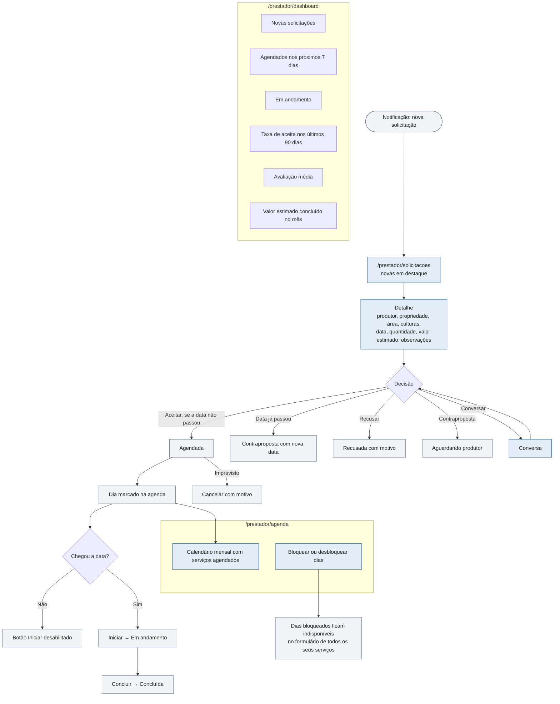

---

## 8. Prestador: verificação

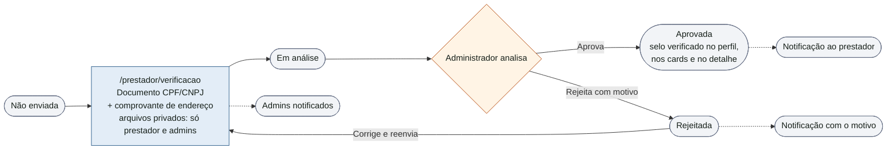

---

## 9. Administrador: usuários e suspensão

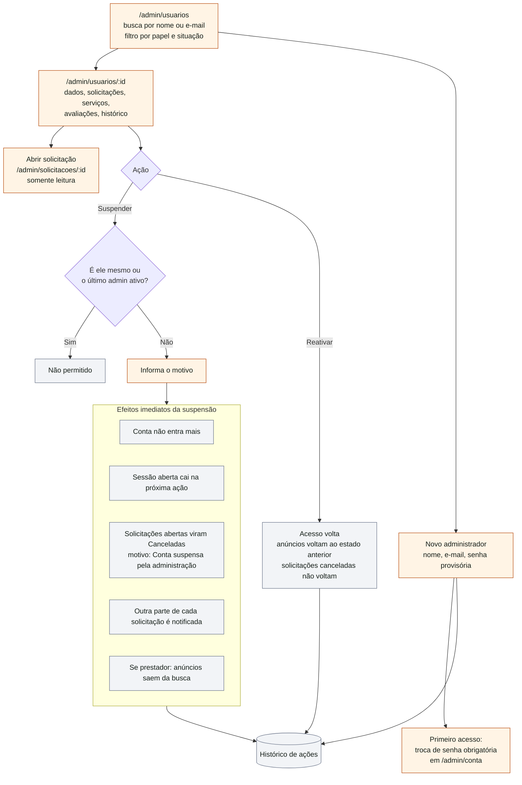

---

## 10. Administrador: denúncias

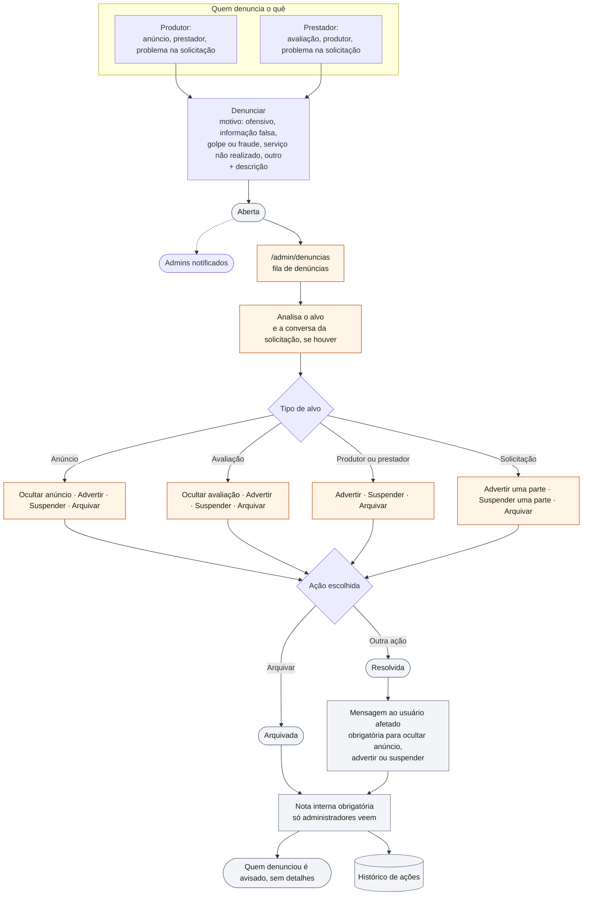

Advertir envia uma notificação ao usuário com a mensagem escrita pelo administrador. A nota interna nunca é enviada a usuários.

---

## 11. Administrador: anúncios e categorias

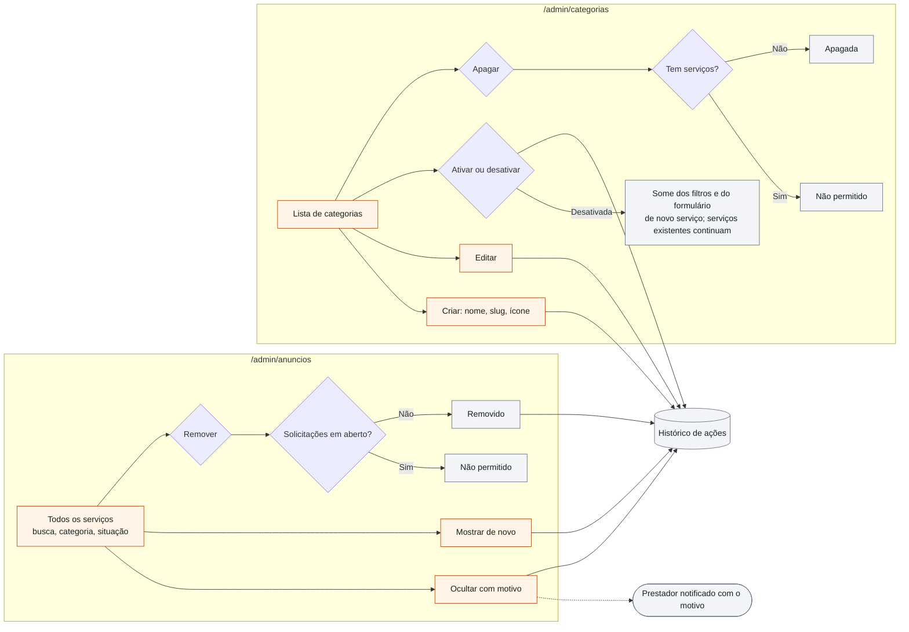

---

## 12. Avaliações

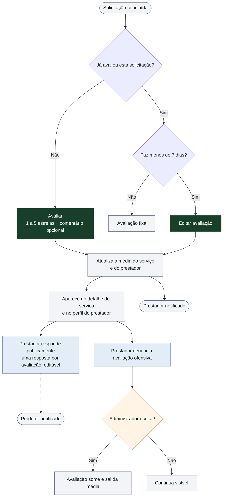

---

## 13. Notificações e conversa

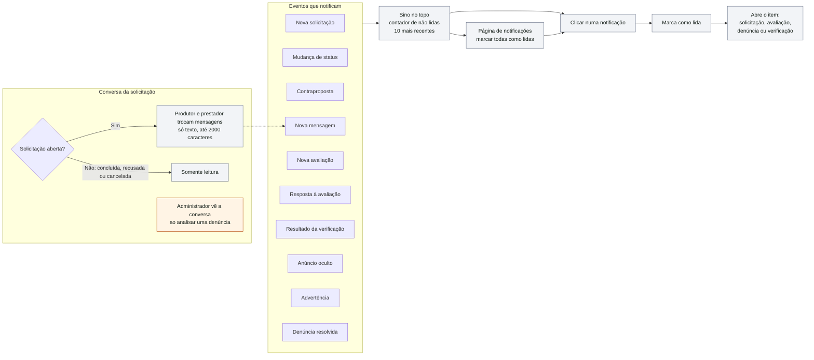

Notificações aparecem só dentro do sistema. Não há e-mail, SMS ou push nesta etapa.
