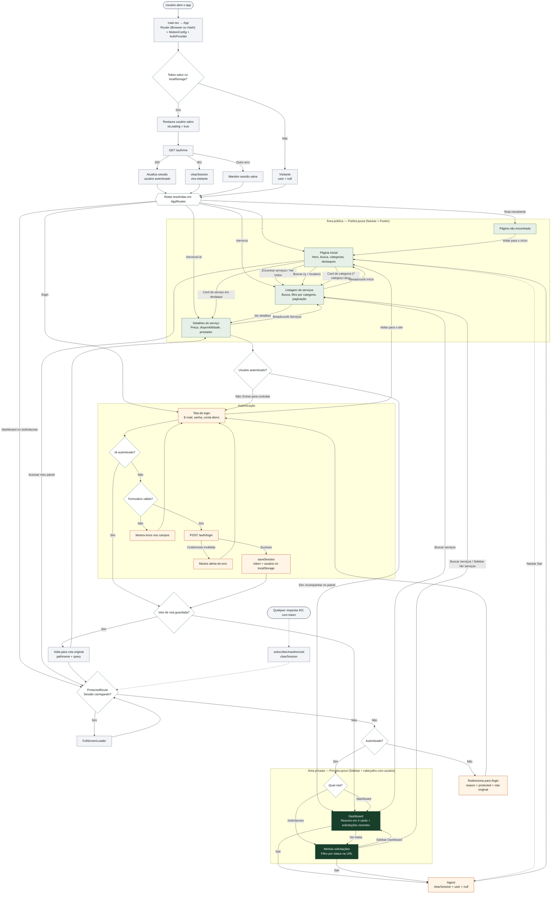
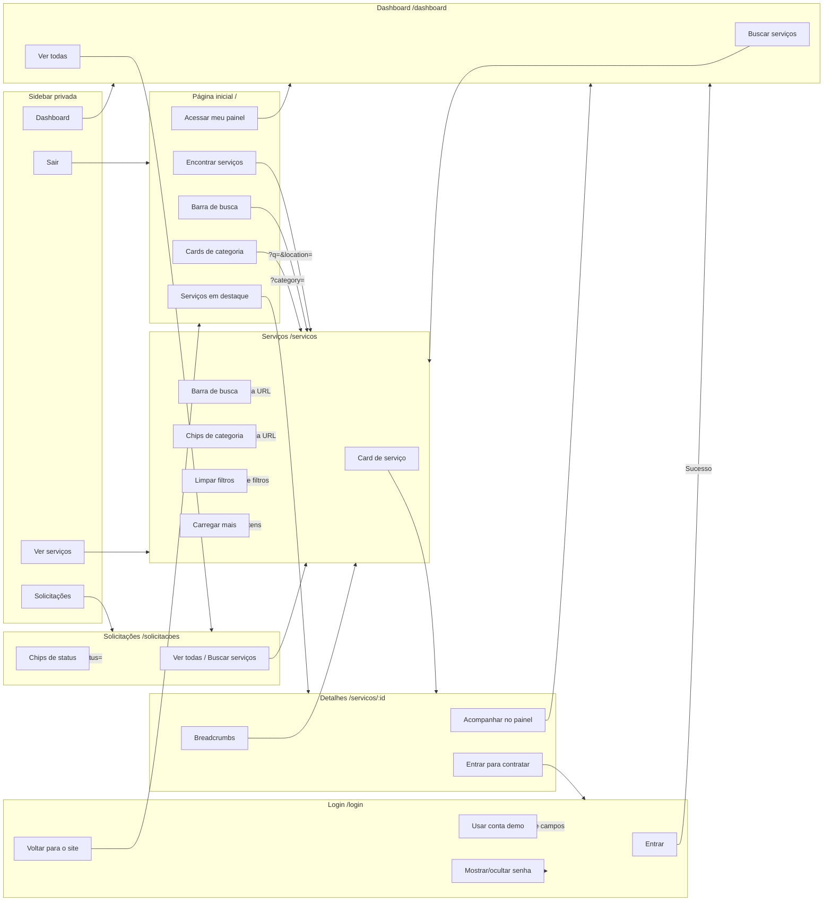
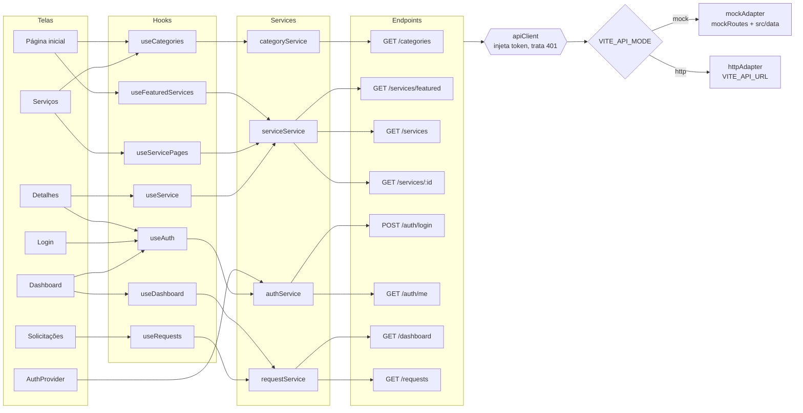
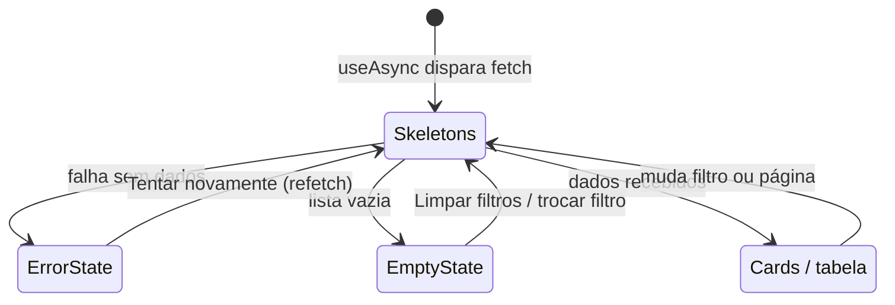

# AgroServ — Fluxograma do Sistema

Visão única de como as telas se conectam e de como o sistema funciona por trás delas: inicialização, autenticação, proteção de rotas, carregamento de dados e estados de cada tela.

Para os diagramas detalhados por assunto, veja [flowcharts.md](flowcharts.md). Para o sistema planejado, com produtor, prestador e administrador, veja [future-flowcharts.md](future-flowcharts.md).

1. [Fluxograma completo](#1-fluxograma-completo)
2. [Telas e ações](#2-telas-e-ações)
3. [Telas e dados consumidos](#3-telas-e-dados-consumidos)
4. [Legenda](#4-legenda)

---

## 1. Fluxograma completo

---

## 2. Telas e ações

---

## 3. Telas e dados consumidos

Cada tela chama um hook, que chama um service, que passa pelo `apiClient`. O adaptador é escolhido por `VITE_API_MODE`: mock (padrão, dados locais em `src/data`) ou HTTP real.

Toda tela que carrega dados segue o mesmo ciclo de estados:

---

## 4. Legenda

| Cor | Significado |
|-----|-------------|
| Verde-claro | Telas públicas (`PublicLayout`) |
| Verde-escuro | Telas privadas (`PrivateLayout`, exigem login) |
| Laranja-claro | Autenticação e sessão |
| Cinza | Processos internos do sistema |
| Branco | Decisões |
| Linha tracejada | Evento assíncrono ou alternativo |

| Rota | Tela | Acesso | Arquivo |
|------|------|--------|---------|
| `/` | Página inicial | Pública | `src/pages/HomePage.tsx` |
| `/servicos` | Listagem de serviços | Pública | `src/pages/ServicesPage.tsx` |
| `/servicos/:id` | Detalhes do serviço | Pública | `src/pages/ServiceDetailPage.tsx` |
| `/login` | Login | Pública | `src/pages/LoginPage.tsx` |
| `/dashboard` | Dashboard do produtor | Privada | `src/pages/DashboardPage.tsx` |
| `/solicitacoes` | Minhas solicitações | Privada | `src/pages/RequestsPage.tsx` |
| `*` | Página não encontrada | Pública | `src/pages/NotFoundPage.tsx` |
