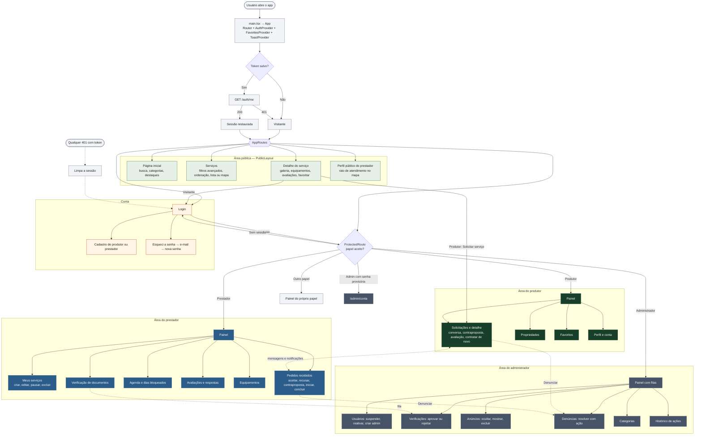
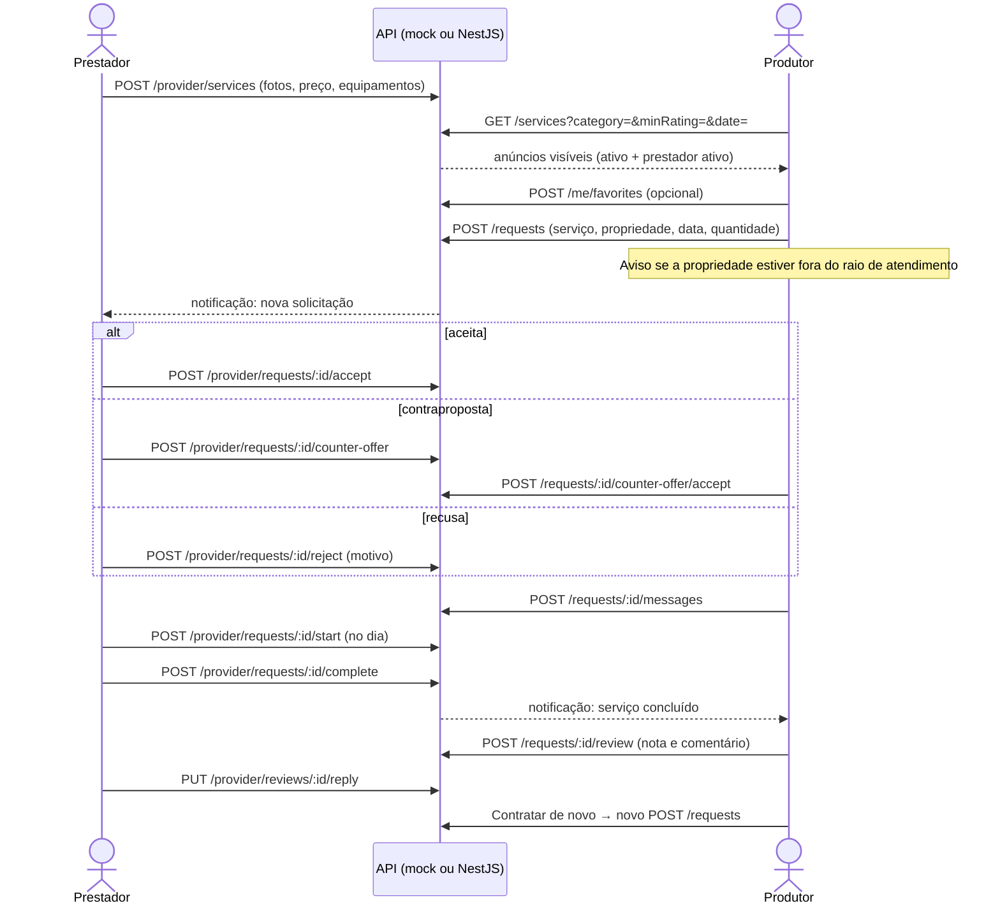
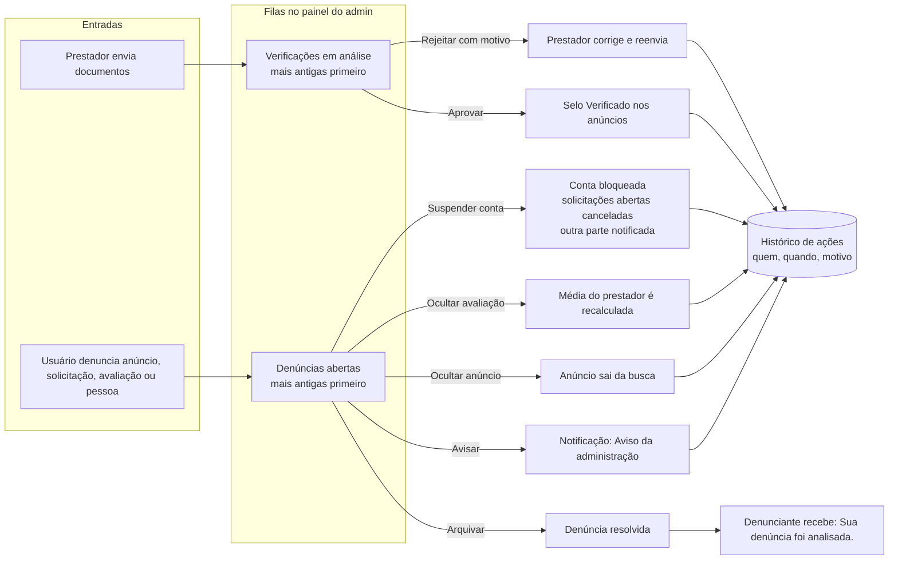
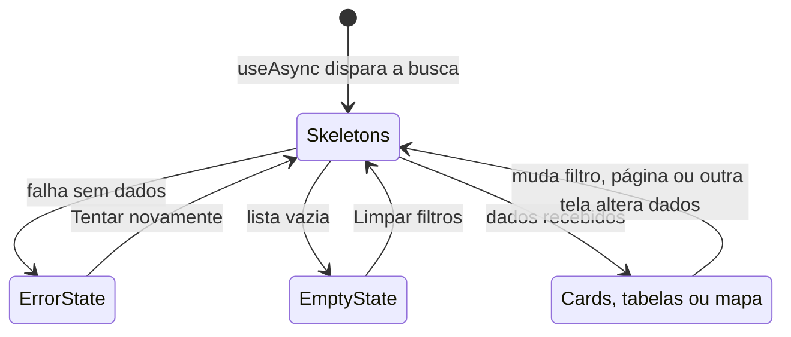

# AgroServ — Fluxograma do Sistema

Visão única do sistema completo: como o app inicia, como cada papel entra na sua área, como produtor e prestador fecham um serviço e como a administração modera a plataforma. Front-end e back-end seguem o mesmo contrato ([`api-contract.md`](api-contract.md)), então os fluxos valem nos dois modos (`mock` e `http`).

Para os diagramas detalhados por assunto, com imagens, veja [flowcharts.md](flowcharts.md).

1. [Fluxograma completo](#1-fluxograma-completo)
2. [Jornada de um serviço](#2-jornada-de-um-serviço)
3. [Moderação](#3-moderação)
4. [Telas e dados consumidos](#4-telas-e-dados-consumidos)
5. [Rotas](#5-rotas)
6. [Legenda](#6-legenda)

---

## 1. Fluxograma completo

---

## 2. Jornada de um serviço

Do anúncio à avaliação. Cada passo grava um evento na linha do tempo da solicitação e notifica a outra parte.

---

## 3. Moderação

---

## 4. Telas e dados consumidos

Cada tela chama um hook, que chama um service, que passa pelo `apiClient`. O adaptador é escolhido por `VITE_API_MODE`: `mock` (padrão, dados demo no `localStorage`) ou `http` (back-end NestJS em `VITE_API_URL`).

| Área | Telas | Endpoints principais |
|---|---|---|
| Pública | Início, serviços (lista e mapa), detalhe, perfil do prestador | `GET /categories`, `GET /services`, `GET /services/featured`, `GET /services/:id`, `GET /services/:id/reviews`, `GET /services/:id/blocked-days`, `GET /providers/:id` |
| Conta | Login, cadastro, recuperação, perfil | `POST /auth/login`, `POST /auth/register`, `GET /auth/me`, `POST /auth/forgot-password`, `POST /auth/reset-password`, `PATCH /me`, `PATCH /me/password`, `DELETE /me`, `POST /uploads` |
| Produtor | Painel, solicitações, propriedades, favoritos | `GET /dashboard`, `GET/POST /requests`, `GET /requests/:id`, `POST /requests/:id/cancel`, `POST /requests/:id/counter-offer/accept\|decline`, `POST /requests/:id/review`, `PATCH /reviews/:id`, `GET/POST/PATCH/DELETE /me/properties`, `GET/POST/DELETE /me/favorites` |
| Prestador | Painel, anúncios, pedidos, agenda, avaliações, equipamentos, verificação | `GET /provider/dashboard`, `GET/POST/PATCH/DELETE /provider/services`, `POST /provider/services/:id/pause\|activate`, `GET /provider/requests`, `POST /provider/requests/:id/accept\|reject\|counter-offer\|start\|complete\|cancel`, `GET /provider/agenda`, `POST /provider/blocked-days`, `DELETE /provider/blocked-days/:date`, `GET /provider/reviews`, `PUT /provider/reviews/:id/reply`, `GET/POST/PATCH/DELETE /provider/equipment`, `GET/POST /provider/verification`, `GET/PATCH /provider/profile` |
| Conversa e avisos | Detalhe da solicitação, sino, notificações, denúncias | `GET/POST /requests/:id/messages`, `GET /me/notifications`, `POST /me/notifications/:id/read`, `POST /me/notifications/read-all`, `POST /reports` |
| Administrador | Painel, usuários, verificações, anúncios, denúncias, categorias, histórico | `GET /admin/dashboard`, `GET/POST /admin/users`, `POST /admin/users/:id/suspend\|reactivate`, `GET /admin/requests/:id`, `GET /admin/verifications`, `POST /admin/verifications/:id/approve\|reject`, `GET /admin/services`, `POST /admin/services/:id/hide\|show`, `DELETE /admin/services/:id`, `GET /admin/reports`, `POST /admin/reports/:id/resolve`, `GET/POST/PATCH/DELETE /admin/categories`, `GET /admin/actions` |

Toda tela que carrega dados segue o mesmo ciclo de estados:

---

## 5. Rotas

| Rota | Tela | Acesso | Arquivo |
|---|---|---|---|
| `/` | Página inicial | Pública | `src/pages/HomePage.tsx` |
| `/servicos` | Serviços, lista ou mapa | Pública | `src/pages/ServicesPage.tsx` |
| `/servicos/:id` | Detalhe do serviço | Pública | `src/pages/ServiceDetailPage.tsx` |
| `/prestadores/:id` | Perfil público do prestador | Pública | `src/pages/ProviderPublicProfilePage.tsx` |
| `/termos`, `/privacidade` | Termos de uso e privacidade | Pública | `src/pages/TermsPage.tsx`, `src/pages/PrivacyPage.tsx` |
| `/login` | Login | Pública | `src/pages/LoginPage.tsx` |
| `/cadastro` | Cadastro | Pública | `src/pages/RegisterPage.tsx` |
| `/esqueci-senha`, `/redefinir-senha` | Recuperação de senha | Pública | `src/pages/ForgotPasswordPage.tsx`, `src/pages/ResetPasswordPage.tsx` |
| `/dashboard` | Painel do produtor | Produtor | `src/pages/DashboardPage.tsx` |
| `/solicitacoes`, `/solicitacoes/:id` | Solicitações e detalhe | Produtor | `src/pages/RequestsPage.tsx`, `src/pages/RequestDetailPage.tsx` |
| `/propriedades` | Propriedades | Produtor | `src/pages/PropertiesPage.tsx` |
| `/favoritos` | Favoritos | Produtor | `src/pages/FavoritesPage.tsx` |
| `/perfil` | Perfil e conta | Produtor | `src/pages/ProfilePage.tsx` |
| `/prestador/dashboard` | Painel do prestador | Prestador | `src/pages/ProviderDashboardPage.tsx` |
| `/prestador/servicos`, `/novo`, `/:id/editar` | Anúncios | Prestador | `src/pages/MyServicesPage.tsx`, `src/pages/ServiceFormPage.tsx` |
| `/prestador/solicitacoes`, `/:id` | Pedidos recebidos | Prestador | `src/pages/ProviderRequestsPage.tsx`, `src/pages/ProviderRequestDetailPage.tsx` |
| `/prestador/agenda` | Agenda | Prestador | `src/pages/AgendaPage.tsx` |
| `/prestador/avaliacoes` | Avaliações | Prestador | `src/pages/ProviderReviewsPage.tsx` |
| `/prestador/equipamentos` | Equipamentos | Prestador | `src/pages/EquipmentPage.tsx` |
| `/prestador/verificacao` | Verificação | Prestador | `src/pages/VerificationPage.tsx` |
| `/prestador/perfil` | Perfil profissional | Prestador | `src/pages/ProviderProfilePage.tsx` |
| `/admin` | Painel do administrador | Administrador | `src/pages/AdminDashboardPage.tsx` |
| `/admin/usuarios`, `/:id` | Usuários | Administrador | `src/pages/AdminUsersPage.tsx`, `src/pages/AdminUserDetailPage.tsx` |
| `/admin/solicitacoes/:id` | Solicitação (somente leitura) | Administrador | `src/pages/AdminRequestDetailPage.tsx` |
| `/admin/verificacoes` | Verificações | Administrador | `src/pages/AdminVerificationsPage.tsx` |
| `/admin/anuncios` | Anúncios | Administrador | `src/pages/AdminServicesPage.tsx` |
| `/admin/denuncias`, `/:id` | Denúncias | Administrador | `src/pages/AdminReportsPage.tsx`, `src/pages/AdminReportDetailPage.tsx` |
| `/admin/categorias` | Categorias | Administrador | `src/pages/AdminCategoriesPage.tsx` |
| `/admin/historico` | Histórico de ações | Administrador | `src/pages/AdminActionsPage.tsx` |
| `/admin/conta` | Minha conta | Administrador | `src/pages/AdminAccountPage.tsx` |
| `/notificacoes`, `/prestador/notificacoes`, `/admin/notificacoes` | Notificações | Cada papel | `src/pages/NotificationsPage.tsx` |
| `*` | Página não encontrada | Pública | `src/pages/NotFoundPage.tsx` |

---

## 6. Legenda

| Cor | Significado |
|---|---|
| Verde-claro | Telas públicas (`PublicLayout`) |
| Verde-escuro | Área do produtor |
| Azul | Área do prestador |
| Cinza-escuro | Área do administrador |
| Laranja-claro | Autenticação e conta |
| Cinza-claro | Processos internos do sistema |
| Linha tracejada | Evento assíncrono ou alternativo |
